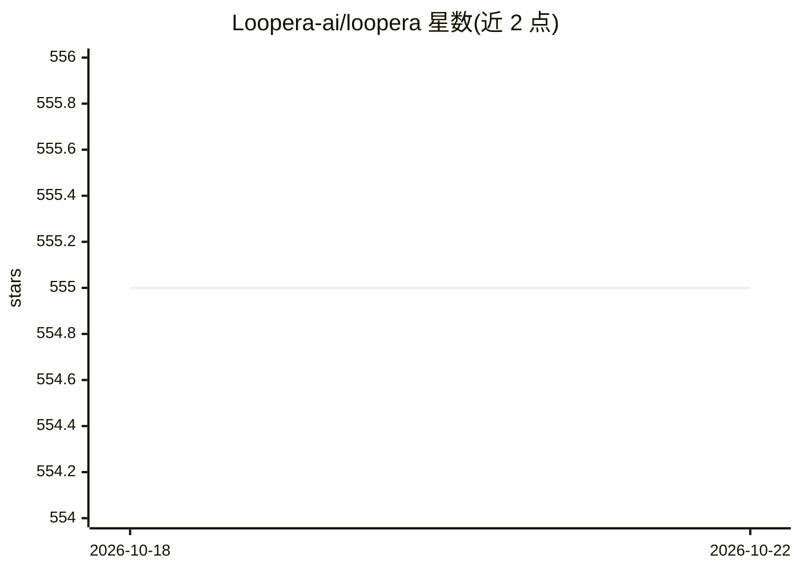

# Loopera-ai/loopera

⭐ 548 · NOASSERTION · 推送 2026-09-21 · [GitHub](https://github.com/Loopera-ai/loopera) · [官网](https://loopera.cn) · 组织维护 · 中文 README

**面向基本面量化团队的研究智能体产品（公开资料仓库，无代码）**

Loopera 是围绕上市公司财务报表的基本面因子研究智能体产品：从 Topic/Prompt/PDF 三种输入出发，经发现现象、形成假设、构建候选因子、多层证据门验证到研究记忆沉淀的闭环流程，由 AI Agent、Research Contract、确定性 Harness 与研究记忆协同完成。本仓库为公开产品与技术资料仓库，声明不提供可运行代码、安装包、CLI 或公开 API。License 为 BSL 1.1（声明 not open source），状态为 public preview。

## 筛选速览

| 维度 | 判定 | 备注 |
|---|---|---|
| AI 角色 | `ai-native` | 本体是模型或模型工具 |
| 许可风险 | `none` | NOASSERTION |
| 部署形态 | `None` |  |
| 模型依赖 | — | README 未给出锁定关系 |
| 硬件要求 | — | 无带数字的原话,不猜 |
| 安装摩擦 | `low` | 无编译、无系统依赖或容器化 |
| 成熟度 | `idea` | |

## 能力要点

- Topic/Prompt/PDF 三种输入统一进入研究主线并保留来源可追溯
- 六阶段研究闭环与六类证据门（时点、口径、逻辑、新颖性等）逐层筛选候选
- 研究记忆保存成功、失败原因与研究谱系供下轮复用
- 内部运行快照：147 次候选尝试、66 项结构化假设、5 个入库候选

## 适用场景

- 基本面量化团队扩展研究覆盖并建立可复核的因子研究流程
- 投研机构把内部报告（PDF）中的观点与公式接入标准化验证链路
- 研究管理者追踪研究来源、失败原因与后续方向
- 减少因子研究中重复试错并沉淀团队研究知识

## 场景标签

`金融量化` · 领域:学习与行业

## 证据(README 行号)

> L51: Loopera 围绕上市公司的财务报表与经营信息，为基本面量化团队持续完成**研究方向探索、经济假设形成、候选因子构建、可信验证与知识沉淀**。
> L195: - **AI Agent** 扩展研究空间，负责提出、解释与修订想法；

## 星数曲线

2026-10-18 555 → 2026-10-22 555（+0）

---
*卡片 v1 · prompt 1.4 · 生成 2026-10-21 · 置信度 high · 依据 README sha `3d74225d7e07` · [字段定义](../../DATASET.md)*
