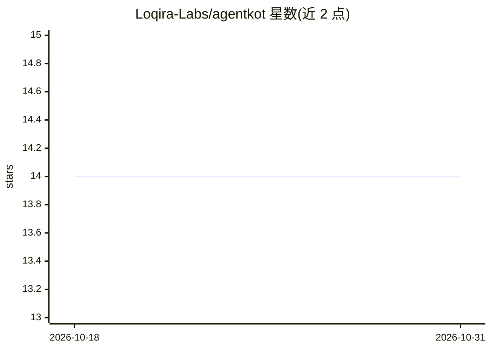

# Loqira-Labs/agentkot

⭐ 14 · 推送 2026-10-01 · [GitHub](https://github.com/Loqira-Labs/agentkot) · [官网](https://agentkot.ai) · 组织维护 · 中文 README

**自托管单文件多 provider AI agent 编排运行时**

以单个可执行文件形式分发的 agent harness：内置 web 界面、shell/文件/搜索/记忆/媒体生成/编排工具，可读取代码与文档、编辑文件、执行命令，并通过 Agent{spawn|delegate|hire} 让多个 agent 分别运行在不同 provider 的不同模型上组成团队。明确不提供沙箱、权限确认、skills 子系统与 MCP 隔离，隔离由外部环境（容器/虚拟机）承担。以预编译二进制分发（Linux/macOS/Windows），运行依赖 PATH 中的 ripgrep 与 git。

## 筛选速览

| 维度 | 判定 | 备注 |
|---|---|---|
| AI 角色 | `ai-ecosystem` | LLM/agent 周边工具 |
| 许可风险 | `none` | — |
| 部署形态 | `desktop` | 安装包/桌面程序 |
| 模型依赖 | local-ok | 支持本地模型 |
| 硬件要求 | — | 无带数字的原话,不猜 |
| 安装摩擦 | `low` | 无编译、无系统依赖或容器化 |
| 成熟度 | — | 结构信号不足 |

## 能力要点

- 单可执行文件：web UI、工具、记忆与编排内嵌于二进制
- 多 provider 团队编排：子 agent 可指定 provider/model，运行中可切换
- 支持 16 种 provider 接入（OAuth 订阅或 API key），ollama/lmstudio 可无 key 本地运行
-  kot doctor 检查环境依赖与凭据状态

## 适用场景

- 在本机跨多个 LLM 提供商组建分工的多 agent 团队
- 通过 web 界面驱动 agent 执行代码阅读、文件编辑与命令运行
- 在容器或虚拟机内自行隔离运行高风险 agent 任务

## 场景标签

`Agent 框架` `多智能体` · 领域:Agent 开发

## 证据(README 行号)

> L9: The best working agent you can install on your own machine. One executable: it reads code and documents, searches th
> L25: One agent on one model is either slow, or shallow, or a bottleneck. Here roles are spread across providers, and eve
> L166: Supported: `anthropic`, `anthropic-oauth`, `openai`, `openai-codex`, `gemini`, `deepseek`, `grok`, `openrouter`, `

## 星数曲线

2026-10-18 14 → 2026-10-31 14（+0）

---
*卡片 v1 · prompt 1.4 · 生成 2026-10-31 · 置信度 high · 依据 README sha `8db2a00d4293` · [字段定义](../../DATASET.md)*
