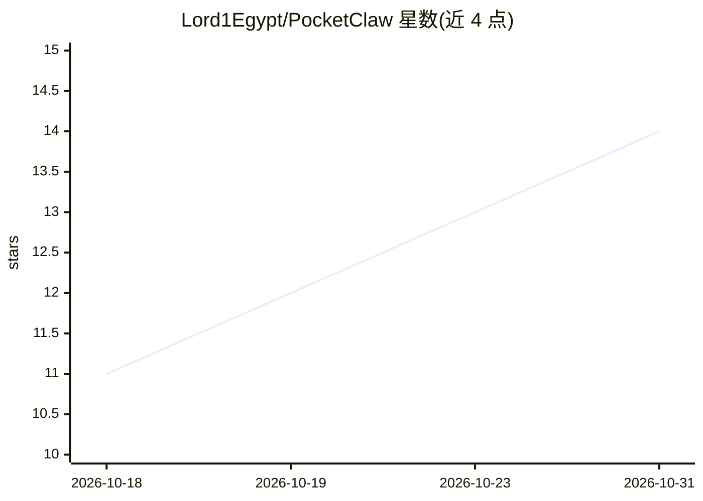

# Lord1Egypt/PocketClaw

⭐ 14 · Go · MIT · 推送 2026-09-27 · [GitHub](https://github.com/Lord1Egypt/PocketClaw) · [官网](https://github.com/Lord1Egypt/PocketClaw/releases/latest) · 个人维护 · 中文 README

**运行在 Android 手机上的私人 AI agent：本地网关+工具，模型远端**

单个 Android APK 封装完整 agent 运行时：内置 Go 网关（仅绑定 127.0.0.1:18790）、Web 仪表盘和 8 个为 arm64-v8a 编译的版本锁定命令行工具（python/git/gh/sqlite3 等），agent 在手机本地执行克隆仓库、跑脚本、查数据库等操作；模型通过 API key 接入远端提供商。支持 Anthropic、OpenAI 兼容端点、Azure OpenAI、AWS Bedrock 等，可配置 Telegram 等 15 个渠道。要求 Android 8.0+、arm64-v8a 设备。基于 MIT 许可的 PicoClaw（Sipeed）构建，非 Git fork。

## 筛选速览

| 维度 | 判定 | 备注 |
|---|---|---|
| AI 角色 | `ai-native` | 本体是模型或模型工具 |
| 许可风险 | `permissive` | MIT |
| 部署形态 | `desktop` | 安装包/桌面程序 |
| 模型依赖 | locked-api |  |
| 硬件要求 | — | 无带数字的原话,不猜 |
| 安装摩擦 | `low` | 无编译、无系统依赖或容器化 |
| 成熟度 | — | 结构信号不足 |

## 能力要点

- 设备端 Go 网关仅绑定 loopback，8 个 arm64 工具随 APK 打包、版本锁定
- 支持 Anthropic/OpenAI 兼容/Azure OpenAI/AWS Bedrock 等模型提供商
- 15 个可配置渠道（Telegram 引导式接入，另含 discord/slack/matrix/qq 等）
- 可复现构建与签名校验（SHA-256、apksigner、release gate）

## 适用场景

- 在 Android 手机上运行带真实 shell 工具的 AI agent，无需开发机
- 通过 Telegram 等渠道远程与手机上的 agent 对话
- 在本地仪表盘管理提供商、渠道、技能与日志

## 场景标签

`AI 助手` `聊天机器人` · 领域:对话与助手

## 证据(README 行号)

> L74: PocketClaw packages a full agent runtime into a single Android app. It ships its
> L80: You bring an API key for whichever model provider you prefer. PocketClaw brings

## 星数曲线

2026-10-18 11 → 2026-10-31 14（+3）

---
*卡片 v1 · prompt 1.4 · 生成 2026-10-31 · 置信度 high · 依据 README sha `ef1595d402aa` · [字段定义](../../DATASET.md)*
