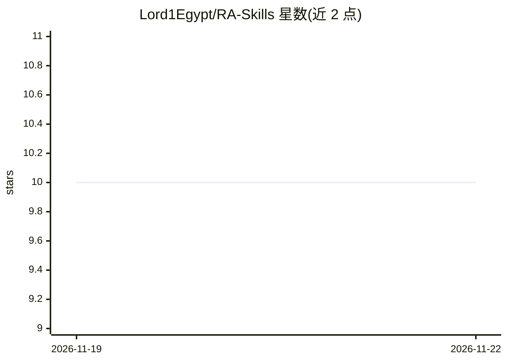

# Lord1Egypt/RA-Skills

⭐ 10 · 推送 2026-11-17 · [GitHub](https://github.com/Lord1Egypt/RA-Skills) · [官网](https://github.com/Lord1Egypt/RA-Skills) · 个人维护

**离线可用的 90,896 条 Hermes Agent 技能聚合仓库**

聚合 7 个来源（ClawHub、skills.sh、LobeHub、gstack、browse.sh 及官方内建/可选技能）共 90,896 条 agent 技能的离线注册表，其中约 88% 社区技能以完整文件夹形式内嵌（含 SKILL.md、scripts、references、assets），克隆后可完全离线检索与使用。提供 Python/JS 搜索库、CLI（search/show/stats/get）与批量下载、自动更新工具，GitHub Actions 每 48 小时同步新技能。未内嵌的约 12% 技能需联网抓取，部分上游仓库已删除不可恢复。

## 筛选速览

| 维度 | 判定 | 备注 |
|---|---|---|
| AI 角色 | `ai-knowledge` | 知识聚合/清单类 |
| 许可风险 | `permissive` | — |
| 部署形态 | `library` | 以包/库形式分发 |
| 模型依赖 | — | README 未给出锁定关系 |
| 硬件要求 | — | 无带数字的原话,不猜 |
| 安装摩擦 | `low` | 无编译、无系统依赖或容器化 |
| 成熟度 | — | 结构信号不足 |

## 能力要点

- 90,896 条技能来自 7 个注册源，88% 内嵌完整离线文件夹
- pip/npm 双发行 CLI ra-skills 内置元数据索引，支持离线检索
- 提供 Python/JS API 与 tools/ 下批量下载、注册表更新脚本
- GitHub Actions 每 48 小时自动发现并同步新技能

## 适用场景

- 无网/隔离环境下为 Claude Code、Hermes Agent 等查找本地技能
- 按关键词离线检索 agent 技能并按需下载完整文件夹
- 批量镜像 ClawHub、skills.sh 等来源的技能资产

## 场景标签

`精选清单` · 领域:学习与行业

## 证据(README 行号)

> L3: > A comprehensive, high-performance offline-compatible registry of **90,896** Hermes Agent skills across 7 registrie
> L63:  - **`community/`**: Structured registry of over 90,726 community skills (from ClawHub, skills.sh, LobeHub, browse.
> L117: |Source Registry|Description|Skills Count|

## 星数曲线

2026-11-19 10 → 2026-11-22 10（+0）

---
*卡片 v1 · prompt 1.4 · 生成 2026-11-20 · 置信度 high · 依据 README sha `c88de9422cad` · [字段定义](../../DATASET.md)*
