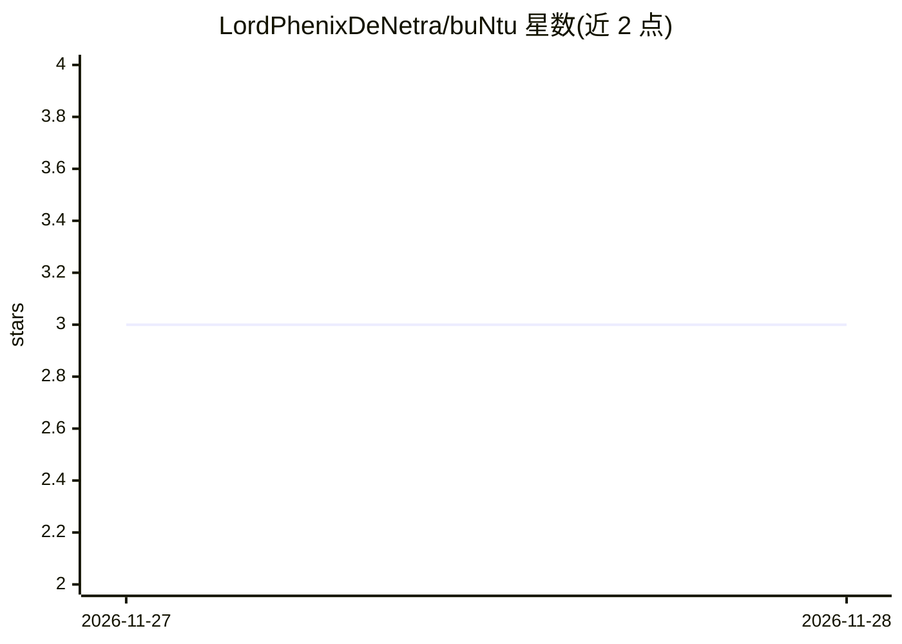

# LordPhenixDeNetra/buNtu

⭐ 3 · Rust · Apache-2.0 · 推送 2026-11-26 · [GitHub](https://github.com/LordPhenixDeNetra/buNtu) · 个人维护

**给开发者的 Rust 开源 AI 网关：统一 API 接入 20+ 模型供应商**

以 Rust 编写的 AI 网关（Apache 2.0），提供兼容 OpenAI/Anthropic 的统一端点，面向需统一管理多家模型供应商的开发者。当前状态为初始 alpha（无公开发布版本），已实现：管道、加权密钥、重试、别名、回退、超时，OpenAI/Anthropic/Gemini 及 OpenAI 兼容后端接入，chat/embeddings/models API，SQLite 存储与迁移，/metrics 指标，嵌入式 Web 控制台（FR/EN）。语义缓存、预算、MCP 网关、SSO/RBAC/审计、集群尚未交付。

## 筛选速览

| 维度 | 判定 | 备注 |
|---|---|---|
| AI 角色 | `ai-ecosystem` | LLM/agent 周边工具 |
| 许可风险 | `permissive` | Apache-2.0 |
| 部署形态 | `None` |  |
| 模型依赖 | local-ok | 支持本地模型 |
| 硬件要求 | — | 无带数字的原话,不猜 |
| 安装摩擦 | `medium` | 含编译或系统依赖之一 |
| 成熟度 | `idea` | |

## 能力要点

- 统一 OpenAI 兼容 API 面向 20+ 供应商，含自动回退与负载分担
- 支持 vLLM、Groq、OpenRouter、Ollama 等 OpenAI 兼容后端
- 嵌入式 Web 控制台（rust-embed），i18n FR/EN，含供应商/路由/请求日志界面
- SQLite 存储 + AES-256-GCM 密钥加密 + /metrics 指标端点

## 适用场景

- 在本地为多个模型供应商配置统一 API 入口与回退路由
- 通过 Web 控制台查看请求日志、路由与供应商配置
- 接入 Ollama/vLLM 等本地后端供应用调用

## 场景标签

`模型网关` · 领域:Agent 开发

## 证据(README 行号)

> L5: Passerelle IA open source en Rust, sous licence Apache 2.0. Objectif : une API unique
> L11: > **Statut : alpha initiale.** La passerelle fonctionne localement : endpoints compatibles
> L43: |API : `/v1/chat/completions` (JSON + SSE), `/v1/embeddings`, `/v1/models`, `/anthropic/v1/messages`|fait (T1.13–T1

## 星数曲线

2026-11-27 3 → 2026-11-28 3（+0）

---
*卡片 v1 · prompt 1.4 · 生成 2026-11-27 · 置信度 high · 依据 README sha `a8aad1d048a0` · [字段定义](../../DATASET.md)*
