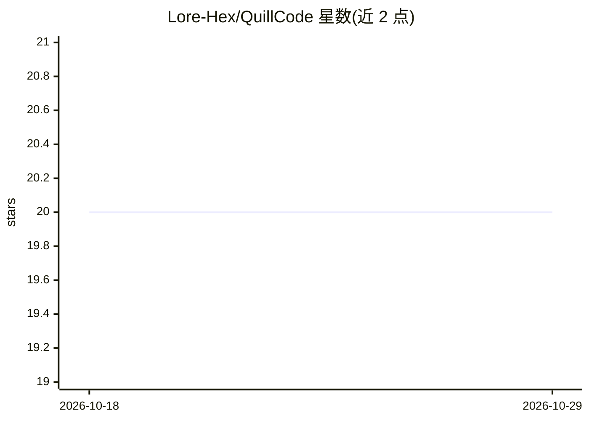

# Lore-Hex/QuillCode

⭐ 20 · Swift · Apache-2.0 · 推送 2026-10-18 · [GitHub](https://github.com/Lore-Hex/QuillCode) · [官网](https://github.com/Lore-Hex/QuillCode/releases/tag/tester-latest) · 组织维护

**原生 macOS Swift 编码代理与 AI 协作桌面应用**

用 Swift/SwiftUI 编写的 macOS 桌面应用，含项目感知聊天、本地文件工具、Git 工作流（分支/worktree/PR）、Computer Use 控制、自动化、插件与 MCP 服务器接入，应用与 agent 运行时均为 Swift 编写，无 Electron。模型调用经 TrustedRouter 目录或命名模型配置，提供用量限额与 Task Limit；更新器带 SHA-256 校验与自动回滚。另提供 Confidential Cowork 企业分发版本。当前为 tester 预览构建，需 macOS 14 以上，亦可用 Swift Package Manager 从源码构建，提供 macOS 与 Linux CLI。

## 筛选速览

| 维度 | 判定 | 备注 |
|---|---|---|
| AI 角色 | `ai-native` | 本体是模型或模型工具 |
| 许可风险 | `permissive` | Apache-2.0 |
| 部署形态 | `None` |  |
| 模型依赖 | — | README 未给出锁定关系 |
| 硬件要求 | — | 无带数字的原话,不猜 |
| 安装摩擦 | `low` | 无编译、无系统依赖或容器化 |
| 成熟度 | `idea` | |

## 能力要点

- 应用与 agent 运行时全部 Swift 编写，无 Electron/Web 壳
- Git 工作流、Computer Use、自动化、插件与 MCP 服务器集成
- TrustedRouter 模型目录与用量限额（日/周/月/总量及 Task Limit）
- 校验式自动更新与失败自动回滚；另有 Confidential Cowork 企业锁版分发

## 适用场景

- 在 macOS 上用编码代理进行多项目的编码、代码审查与 Git 操作
- 通过 Computer Use 与集成终端让代理操作浏览器和系统界面
- 以限额与 Confidential 策略约束企业场景中的模型用量与数据路由

## 场景标签

`编码 Agent` `代码审查` `GUI 自动化` · 领域:效率与自动化

## 证据(README 行号)

> L6: **A 100% Swift coding agent and AI coworker for real project work.**
> L12: Quill Cowork combines project-aware chat, local tools, Git workflows, Computer Use, automations,
> L13: plugins, and a full workspace terminal in one SwiftUI desktop app. The desktop app and agent runtime

## 星数曲线

2026-10-18 20 → 2026-10-29 20（+0）

---
*卡片 v1 · prompt 1.4 · 生成 2026-10-28 · 置信度 high · 依据 README sha `443fe47f77b8` · [字段定义](../../DATASET.md)*
