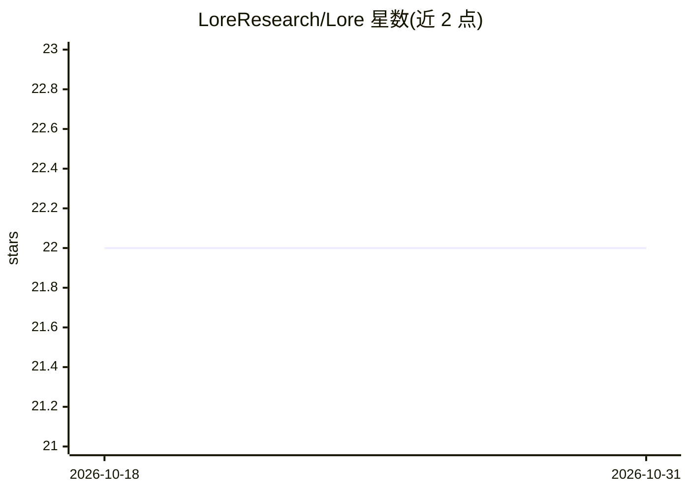

# LoreResearch/Lore

⭐ 22 · TypeScript · MIT · 推送 2026-06-22 · [GitHub](https://github.com/LoreResearch/Lore) · 组织维护

**面向 Solana 代币买家的协议尽调评分 agent，产出配置备忘录**

用 TypeScript 编写的 Solana DeFi 协议研究代理：将治理集中度、费用留存、金库跑道、解锁压力与用户质量五个维度标准化并独立打分，压缩为一个排名，并给出 ACCUMULATE/WATCH/AVOID 结论与多协议对比视图。README 描述其输出为资本配置备忘录形态，宣称忽略虚荣 TVL。提供公式级技术规格说明；示例输出被截断，五个维度的具体数据来源在 README 中未展开。

## 筛选速览

| 维度 | 判定 | 备注 |
|---|---|---|
| AI 角色 | `ai-native` | 本体是模型或模型工具 |
| 许可风险 | `permissive` | MIT |
| 部署形态 | `library` | 以包/库形式分发 |
| 模型依赖 | — | README 未给出锁定关系 |
| 硬件要求 | — | 无带数字的原话,不猜 |
| 安装摩擦 | `low` | 无编译、无系统依赖或容器化 |
| 成熟度 | — | 结构信号不足 |

## 能力要点

- 五维尽调模型：治理/费用留存/金库跑道/解锁压力/用户质量独立打分后取均值
- 输出包含五桶评分、Bullish/Bearish/Action 叙事与 ACCUMULATE/WATCH/AVOID 结论
- 提供协议对比视图（Comparison Strip）与风险控制项（治理集中度惩罚、跑道下限、解锁悬置惩罚）
- 各维度打分公式在 Technical Spec 中给出明确定义

## 适用场景

- 在决定是否配置某 Solana 代币前快速生成一份尽调备忘录
- 把多个协议放在同一评分框架下做相对比较
- 检查代币的治理集中度、金库跑道与近期解锁风险

## 场景标签

`金融量化` · 领域:学习与行业

## 证据(README 行号)

> L3: Protocol diligence engine for Solana token buyers.
> L30: Live operating view for Lore: coverage queue across Solana DeFi protocols, Token Diligence Memo with five-bucket sc

## 星数曲线

2026-10-18 22 → 2026-10-31 22（+0）

---
*卡片 v1 · prompt 1.4 · 生成 2026-10-27 · 置信度 mid · 依据 README sha `7f6beab4e37e` · [字段定义](../../DATASET.md)*
