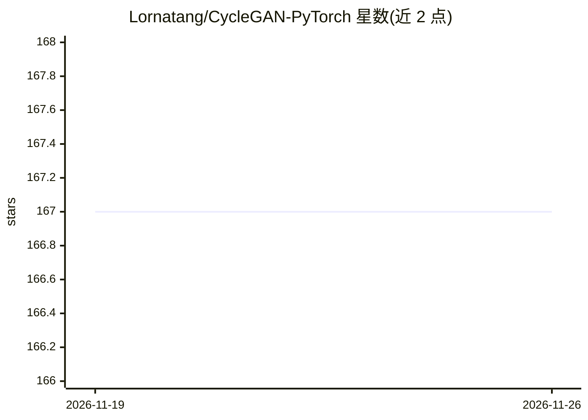

# Lornatang/CycleGAN-PyTorch

⭐ 167 · Python · Apache-2.0 · 推送 2026-11-18 · [GitHub](https://github.com/Lornatang/CycleGAN-PyTorch) · [官网](https://arxiv.org/abs/1703.10593) · 个人维护

**研究者的 CycleGAN 非成对图像翻译 PyTorch 复现**

对论文 Unpaired Image-to-Image Translation using Cycle-Consistent Adversarial Networks 的 PyTorch 逐操作复现，用于在无成对样本条件下学习源域到目标域的图像翻译映射。提供预训练权重（Google Drive/Baidu Drive）与数据集下载入口、YAML 配置驱动的训练脚本（train.py）及断点续训设置方法，并附结果示例与原论文引用。

## 筛选速览

| 维度 | 判定 | 备注 |
|---|---|---|
| AI 角色 | `ai-native` | 本体是模型或模型工具 |
| 许可风险 | `permissive` | Apache-2.0 |
| 部署形态 | `None` |  |
| 模型依赖 | — | README 未给出锁定关系 |
| 硬件要求 | — | 无带数字的原话,不猜 |
| 安装摩擦 | `low` | 无编译、无系统依赖或容器化 |
| 成熟度 | — | 结构信号不足 |

## 能力要点

- CycleGAN 论文的 PyTorch 逐操作复现
- 提供预训练权重与数据集下载（Google Drive/Baidu Drive）
- YAML 配置驱动训练，支持修改配置断点续训

## 适用场景

- 训练苹果↔橙子等非成对图像风格迁移模型
- 学习 CycleGAN 的 PyTorch 实现细节
- 在没有成对训练数据的图像翻译任务上做实验

## 场景标签

`图像生成` `模型训练` · 领域:内容生成

## 证据(README 行号)

> L5: This repository contains an op-for-op PyTorch reimplementation of Unpaired Image-to-Image Translation using Cycle-Co
> L24: python3 train.py --config_path ./configs/CYCLEGAN.yaml

## 星数曲线

2026-11-19 167 → 2026-11-26 167（+0）

---
*卡片 v1 · prompt 1.4 · 生成 2026-11-19 · 置信度 high · 依据 README sha `9c6da07d0c84` · [字段定义](../../DATASET.md)*
