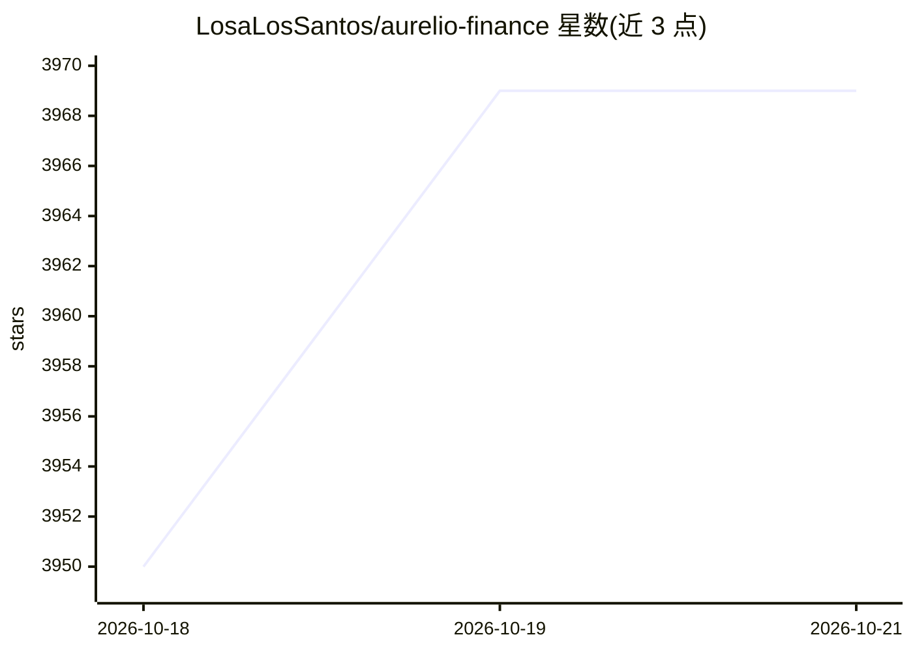

# LosaLosSantos/aurelio-finance

⭐ 3,969 · Python · MIT · 推送 2026-10-19 · [GitHub](https://github.com/LosaLosSantos/aurelio-finance) · 个人维护

**本地运行的个人财富管理应用，带可对话的 AI 财务顾问**

自托管的财富管理与财务规划应用：在本机记录银行、券商现金、持仓、房产、贷款与收支，按市值计算净值与收益，支持基金的 look-through（按国家/行业/公司/货币穿透底层持仓）与目标回报测算。AI 部分可选，经 OpenRouter 使用自有 API key：问答聊天可搜索网络并以确认卡片方式提出变更建议，另提供多角色组合分析。数据存储于本地 backend/data.db，更新前自动备份。需 Git、Node.js 22+ 与 uv，通过 start 脚本启动。

## 筛选速览

| 维度 | 判定 | 备注 |
|---|---|---|
| AI 角色 | `ai-enhanced` | 去掉 AI 部分产品仍成立 |
| 许可风险 | `permissive` | MIT |
| 部署形态 | `None` |  |
| 模型依赖 | locked-api |  |
| 硬件要求 | — | 无带数字的原话,不猜 |
| 安装摩擦 | `low` | 无编译、无系统依赖或容器化 |
| 成熟度 | — | 结构信号不足 |

## 能力要点

- 净值、持仓、分红、贷款、现金流与储蓄率一站式记录，数据存本地
- 基金 look-through：按国家、行业、公司与货币穿透底层持仓
- AI 顾问经 OpenRouter 接入（自带 key，可选），变更以确认卡片形式提出
- 双角色分析：分析师与知己就组合辩论并给出综合结论

## 适用场景

- 在本机集中追踪自己的银行、券商、ETF 与房产债务
- 向 AI 顾问提问自己的财务数据并确认其提出的调整建议
- 查看所持基金的真实底层分布与 ETF 重叠情况

## 场景标签

`聊天机器人` `数据分析` · 领域:效率与自动化

## 证据(README 行号)

> L5: **Aurelio** is a wealth-management and financial-planning app that runs on your
> L7: machine. The AI part is optional: it goes through
> L61: - **Ask Aurelio**: a chat that answers from your own records, can search the

## 星数曲线

2026-10-18 3,950 → 2026-10-21 3,969（+19）

---
*卡片 v1 · prompt 1.4 · 生成 2026-10-21 · 置信度 high · 依据 README sha `e9a557d29ec7` · [字段定义](../../DATASET.md)*
