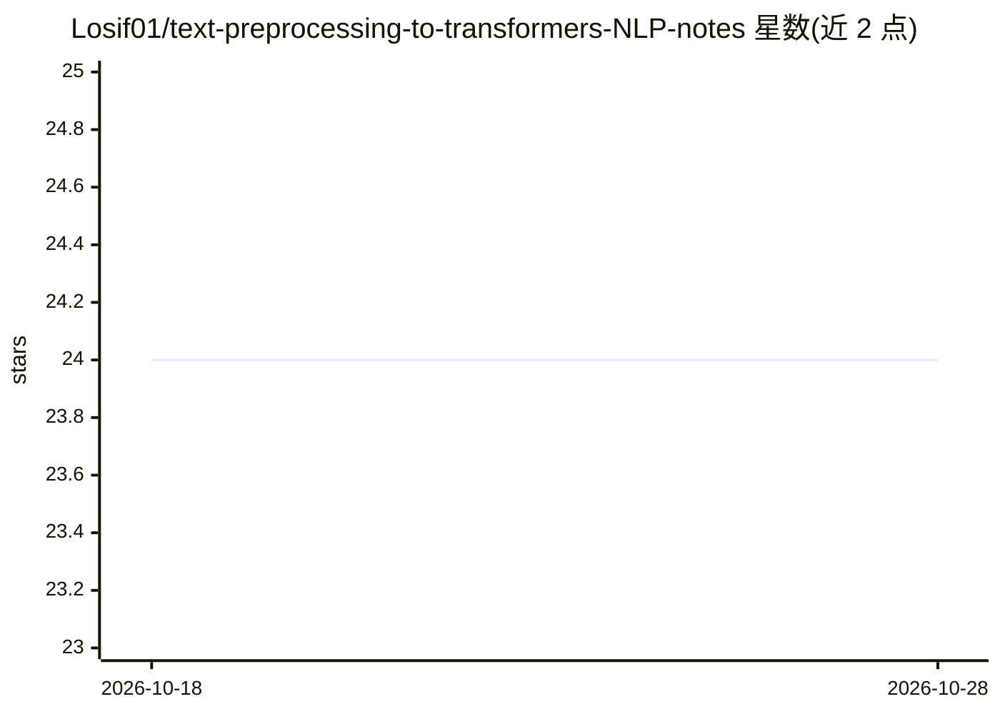

# Losif01/text-preprocessing-to-transformers-NLP-notes

⭐ 24 · GPL-3.0 · 推送 2026-06-08 · [GitHub](https://github.com/Losif01/text-preprocessing-to-transformers-NLP-notes) · 个人维护

**个人斯坦福 NLP 课程学习笔记（至 transformers）**

作者学习斯坦福 NLP 课程（YouTube 可检索）时整理的个人笔记仓库，内容覆盖从文本预处理到 transformers 的主题。每个主题包含理论、代码实现、使用场景说明（何时用哪种方法）、Mermaid 图解、非热门示例（刻意避开 king/queen 类例子）以及预处理算法的解题示例。作者注明建议用 Obsidian 渲染，因 GitHub 对块级公式渲染不佳；目前作为个人参考资料使用。

## 筛选速览

| 维度 | 判定 | 备注 |
|---|---|---|
| AI 角色 | `ai-knowledge` | 知识聚合/清单类 |
| 许可风险 | `viral` | GPL-3.0 |
| 部署形态 | `None` |  |
| 模型依赖 | — | README 未给出锁定关系 |
| 硬件要求 | — | 无带数字的原话,不猜 |
| 安装摩擦 | `low` | 无编译、无系统依赖或容器化 |
| 成熟度 | — | 结构信号不足 |

## 能力要点

- 每个主题包含理论、代码实现与使用场景（when to use what）
- 用 Mermaid 绘制图解
- 提供预处理算法的解题示例
- 刻意选用非常见示例替代 king/queen 类流行例子

## 适用场景

- 作为 NLP 课程学习的参考笔记
- 查阅各预处理与 transformer 主题的代码实现
- 比较不同 NLP 技术的适用场景

## 场景标签

`教程课程` · 领域:学习与行业

## 证据(README 行号)

> L2: This is my personal notes i have been taking while studying the Stanford NLP course, they also have it uploaded on y
> L5: you will find in the notes, not just unorganized gibberish like most students do

## 星数曲线

2026-10-18 24 → 2026-10-28 24（+0）

---
*卡片 v1 · prompt 1.4 · 生成 2026-10-27 · 置信度 high · 依据 README sha `9598d0188277` · [字段定义](../../DATASET.md)*
