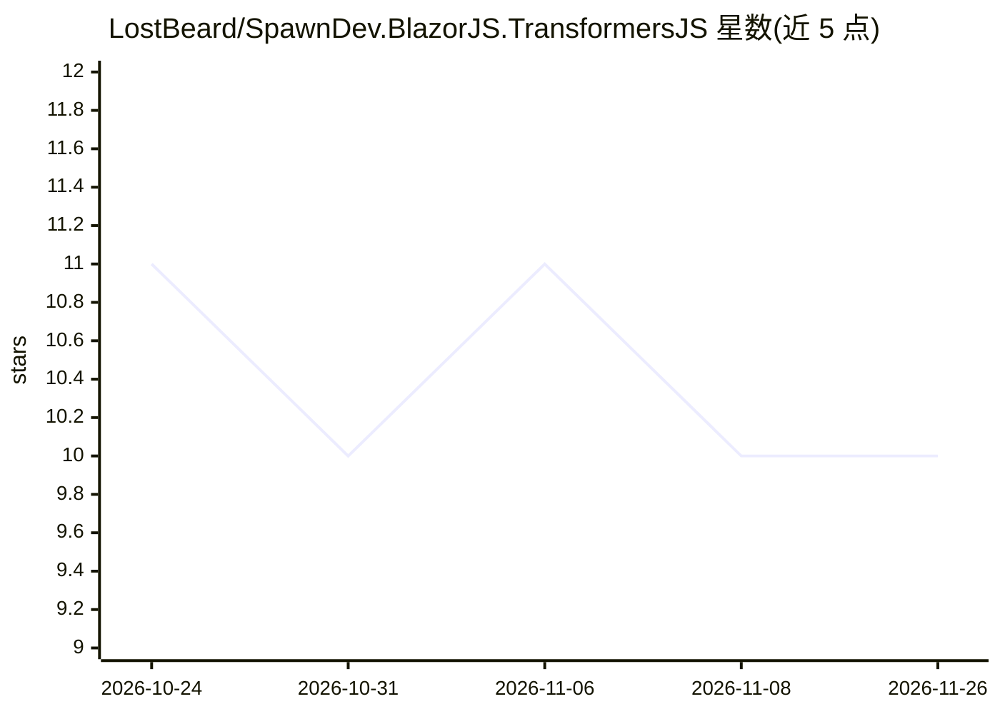

# LostBeard/SpawnDev.BlazorJS.TransformersJS

⭐ 10 · C# · MIT · 推送 2026-11-15 · [GitHub](https://github.com/LostBeard/SpawnDev.BlazorJS.TransformersJS) · [官网](https://lostbeard.github.io/SpawnDev.BlazorJS.TransformersJS/) · 个人维护

**让 .NET 开发者在 Blazor WASM 浏览器中运行预训练模型**

将 Hugging Face 的 Transformers.js（v3.8.1）库引入 Blazor WebAssembly 的 NuGet 库，通过 ONNX Runtime 在浏览器中运行预训练模型，支持 NLP、计算机视觉、音频与多模态任务（文本生成、目标检测、深度估计、语音识别、文生语音等）。以 C# API 调用 Transformers.js，支持 WebGPU/WebGL/WebNN/WASM 执行后端，目标 .NET 8/9/10。模型体积可能较大，需较快网络连接下载。提供多个在线演示（2D 转 3D、图像增强、语音识别等）。

## 筛选速览

| 维度 | 判定 | 备注 |
|---|---|---|
| AI 角色 | `ai-ecosystem` | LLM/agent 周边工具 |
| 许可风险 | `permissive` | MIT |
| 部署形态 | `None` |  |
| 模型依赖 | — | README 未给出锁定关系 |
| 硬件要求 | — | 无带数字的原话,不猜 |
| 安装摩擦 | `medium` | 含编译或系统依赖之一 |
| 成熟度 | — | 结构信号不足 |

## 能力要点

- 在浏览器中通过 ONNX Runtime 运行预训练 Transformer 模型
- 覆盖 NLP、视觉、音频与多模态任务
- 支持 WebGPU、WebGL、WebNN、WASM 执行后端
- 可用 Optimum 将 PyTorch/TensorFlow/JAX 模型转为 ONNX

## 适用场景

- 在 Blazor WebAssembly 应用中直接运行深度学习模型而无需服务器推理
- 浏览器端实现 2D 图像转 3D 深度、图像增强等视觉处理
- 网页端语音识别与文本转语音
- 浏览器内零样本图像/音频分类与嵌入计算

## 场景标签

`语音合成` `语音识别` `目标检测` · 领域:内容生成

## 证据(README 行号)

> L5: `SpawnDev.BlazorJS.TransformersJS` brings the Transformers.js library (v3.8.1) from Hugging Face to Blazor WebAssemb
> L7: Transformers.js is designed to be functionally equivalent to Hugging Face’s transformers python library, meaning you
> L47: Supports WebGPU, WebGL, WebNN, and WASM execution providers. Targets .NET 8, 9, and 10.

## 星数曲线

2026-10-24 11 → 2026-11-26 10（-1）

---
*卡片 v1 · prompt 1.4 · 生成 2026-11-20 · 置信度 high · 依据 README sha `b01a2af2e4ac` · [字段定义](../../DATASET.md)*
