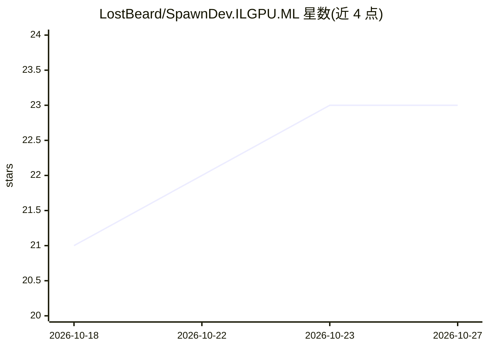

# LostBeard/SpawnDev.ILGPU.ML

⭐ 23 · C# · NOASSERTION · 推送 2026-10-26 · [GitHub](https://github.com/LostBeard/SpawnDev.ILGPU.ML) · [官网](https://lostbeard.github.io/SpawnDev.ILGPU.ML/) · 个人维护

**.NET 神经网络推理与训练引擎，一套 C# 内核跑六种后端**

面向 .NET 开发者的推理与训练引擎：神经网络层以 C# 编写，经 SpawnDev.ILGPU 编译为 WGSL、GLSL、PTX、OpenCL C、WebAssembly 或 SIMD CPU 代码，可运行在浏览器（Blazor WebAssembly）或桌面（Windows/Linux/macOS）。支持自动检测七种模型格式（ONNX、TFLite、GGUF、SafeTensors 等）并统一为一种图 IR；内置生成式模型移植（FLUX、TRELLIS.2 等）、GGUF LLM 推理、Whisper 语音识别及 GPU 内核训练。限制：GGUF 部分量化类型（如 Q5_K、Q2_K）会被拒绝加载；需 .NET 10。

## 筛选速览

| 维度 | 判定 | 备注 |
|---|---|---|
| AI 角色 | `ai-ecosystem` | LLM/agent 周边工具 |
| 许可风险 | `permissive` | NOASSERTION |
| 部署形态 | `None` |  |
| 模型依赖 | local-ok | 支持本地模型 |
| 硬件要求 | — | 无带数字的原话,不猜 |
| 安装摩擦 | `medium` | 含编译或系统依赖之一 |
| 成熟度 | — | 结构信号不足 |

## 能力要点

- 一套代码库覆盖 WebGPU、WebGL、Wasm、CUDA、OpenCL、CPU 六种后端
- 七种模型格式按魔数自动检测，统一为单一图 IR
- GGUF LLM 推理带 KV-cache 解码与 TurboQuant 缓存压缩
- 训练通过 GPU 内核实现反向传播、SGD 与 Adam

## 适用场景

- 在 Blazor WebAssembly 应用中于浏览器内跑模型，数据不出本机
- 在桌面 .NET 应用中跨 CUDA/OpenCL/CPU 运行 ONNX 或 GGUF 模型
- 加载 FLUX、TRELLIS.2 等生成式模型做文生图与文生 3D
- 在浏览器标签页内训练小型网络

## 场景标签

`推理引擎` `模型训练` `图像生成` `语音识别` · 领域:内容生成

## 证据(README 行号)

> L23: SpawnDev.ILGPU.ML is an inference and training engine for .NET whose every layer, from matrix multiply to a 5.6B-pa
> L28: You hand it a model file. It detects the format, builds a graph, optimizes it and runs it on whatever accelerator y

## 星数曲线

2026-10-18 21 → 2026-10-27 23（+2）

---
*卡片 v1 · prompt 1.4 · 生成 2026-10-27 · 置信度 high · 依据 README sha `5a19a6a2e549` · [字段定义](../../DATASET.md)*
