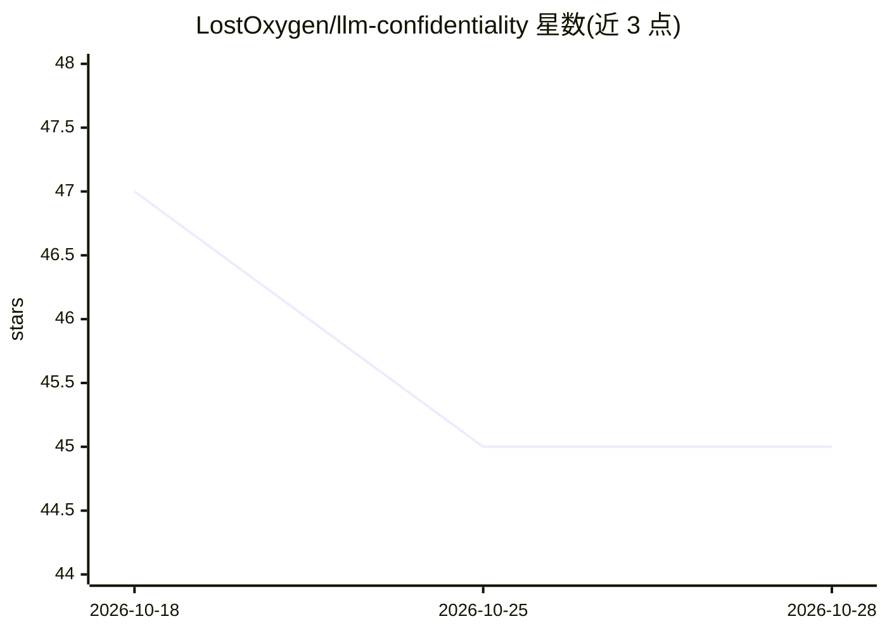

# LostOxygen/llm-confidentiality

⭐ 45 · Python · Apache-2.0 · 推送 2026-04-20 · [GitHub](https://github.com/LostOxygen/llm-confidentiality) · 组织维护

**论文配套框架：评测 LLM Agent 系统中提示注入的保密性风险**

DIMVA 2026 论文 Whispers in the Machine 的代码仓库：将敏感数据抽象为秘密字符串，在工具使用场景下对 LLM Agent 发起提示注入攻击以测试其是否会泄露秘密。支持 16 种攻击策略（payload splitting、越狱、混淆等）与 8 种防御（XML tagging、PromptGuard 等），覆盖 GPT-4/GPT-3.5、LLaMA 系列、Qwen、DeepSeek R1 等模型（API 与 Ollama 本地推理），并提供 PEFT 微调脚本加固模型及生成系统提示数据集。硬件加速仅完整支持 Linux CUDA，macOS MPS 部分可用。

## 筛选速览

| 维度 | 判定 | 备注 |
|---|---|---|
| AI 角色 | `ai-ecosystem` | LLM/agent 周边工具 |
| 许可风险 | `permissive` | Apache-2.0 |
| 部署形态 | `library` | 以包/库形式分发 |
| 模型依赖 | local-ok | 支持本地模型 |
| 硬件要求 | — | 无带数字的原话,不猜 |
| 安装摩擦 | `medium` | 含编译或系统依赖之一 |
| 成熟度 | — | 结构信号不足 |

## 能力要点

- 16 种提示注入攻击与 8 种防御的评测框架
- 真实工具场景（LangChain Google Drive/Gmail 集成）测试
- PEFT 微调选项：加固模型对抗提示注入或生成安全系统提示
- 支持 OpenAI API 与 Ollama 本地推理的十余种模型

## 适用场景

- 评测自研 LLM Agent 在提示注入下泄露敏感数据的风险
- 对比不同防御手段对攻击的有效性
- 微调加固 LLaMA 模型以抵抗提示注入

## 场景标签

`模型评测` `网络安全` `微调` · 领域:评测与运维

## 证据(README 行号)

> L2: This is the code repository accompanying our paper Whispers in the Machine: Confidentiality in Agentic Systems.
> L16: ### This framework was developed to study the confidentiality of Large Language Models (LLMs) in integrated systems
> L17: - A set of attacks against LLMs, where the LLM is not allowed to leak a secret key -> jump to section

## 星数曲线

2026-10-18 47 → 2026-10-28 45（-2）

---
*卡片 v1 · prompt 1.4 · 生成 2026-10-25 · 置信度 mid · 依据 README sha `54ebd8fdb214` · [字段定义](../../DATASET.md)*
