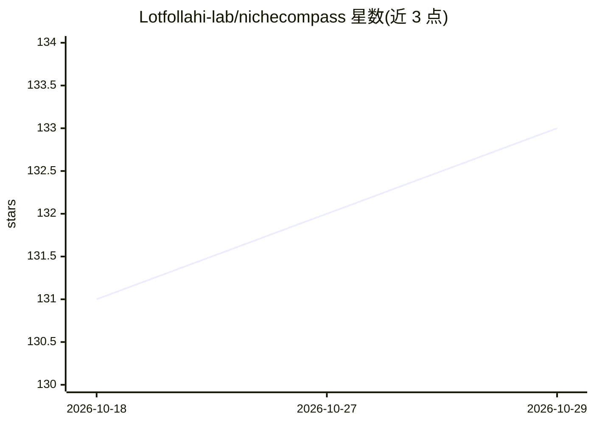

# Lotfollahi-lab/nichecompass

⭐ 133 · Python · BSD-3-Clause · 推送 2026-10-28 · [GitHub](https://github.com/Lotfollahi-lab/nichecompass) · [官网](https://nichecompass.readthedocs.io/) · 组织维护

**空间多组学数据端到端分析包：空间图谱构建与微环境识别**

基于 PyG 与 AnnData 的 Python 包，用于空间多组学数据的端到端分析，涵盖空间图谱构建、微环境（niche）识别与表征、细胞间通讯推断和空间参考映射。方法见于 Birk 等 2025 年论文，作者建议科研引用。提供文档（安装指南、教程与 API 文档），通过 PyPI 分发，使用 Black 代码规范，接受 issue 报告与社区贡献。README 较简略，详细用法需查阅文档与教程。

## 筛选速览

| 维度 | 判定 | 备注 |
|---|---|---|
| AI 角色 | `ai-native` | 本体是模型或模型工具 |
| 许可风险 | `permissive` | BSD-3-Clause |
| 部署形态 | `library` | 以包/库形式分发 |
| 模型依赖 | — | README 未给出锁定关系 |
| 硬件要求 | — | 无带数字的原话,不猜 |
| 安装摩擦 | `low` | 无编译、无系统依赖或容器化 |
| 成熟度 | — | 结构信号不足 |

## 能力要点

- 空间多组学数据端到端分析（图谱构建、微环境识别、通讯推断、参考映射）
- 基于 PyG 与 AnnData 构建
- 配有文档、教程与 API 文档

## 适用场景

- 对空间转录组等空间组学数据做微环境识别与表征
- 构建空间图谱并进行参考映射
- 推断细胞间通讯

## 场景标签

`科研工具` · 领域:学习与行业

## 证据(README 行号)

> L11: NicheCompass (**N**iche **I**dentification based on **C**ellular grap**H** **E**mbeddings of **COM**munication **P*

## 星数曲线

2026-10-18 131 → 2026-10-29 133（+2）

---
*卡片 v1 · prompt 1.4 · 生成 2026-10-22 · 置信度 mid · 依据 README sha `1428a9219079` · [字段定义](../../DATASET.md)*
