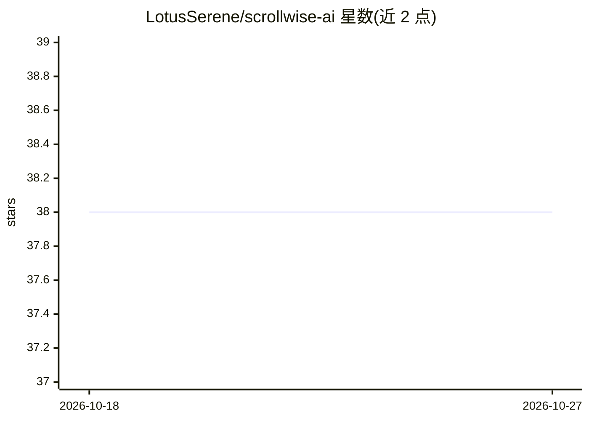

# LotusSerene/scrollwise-ai

⭐ 38 · TypeScript · 推送 2026-06-22 · [GitHub](https://github.com/LotusSerene/scrollwise-ai) · 个人维护

**本地运行的 AI 故事创作与世界构建桌面应用**

面向写作者的桌面应用，提供故事创作、世界构建与创意项目管理功能，AI 作为共同创作入口（含 Codex、Architect Mode、AI 集成等高级功能，默认解锁）。所有数据（故事、世界构建内容、向量）存储在本地，不向服务器发送数据、无云端依赖。以系统托盘应用形式后台运行，通过浏览器（localhost:3000）访问界面。通过 PowerShell 脚本安装与启动，需 Python 3.10+ 与 Node.js 18+，推荐 Windows 环境。

## 筛选速览

| 维度 | 判定 | 备注 |
|---|---|---|
| AI 角色 | `ai-native` | 本体是模型或模型工具 |
| 许可风险 | `none` | — |
| 部署形态 | `None` |  |
| 模型依赖 | — | README 未给出锁定关系 |
| 硬件要求 | — | 无带数字的原话,不猜 |
| 安装摩擦 | `low` | 无编译、无系统依赖或容器化 |
| 成熟度 | — | 结构信号不足 |

## 能力要点

- 故事创作、世界构建与创意项目管理
- 全部数据本地存储，不依赖云端
- Codex、Architect Mode、AI 集成等高级功能默认解锁
- 系统托盘应用，浏览器界面访问

## 适用场景

- 在本地离线创作小说与故事
- 构建和管理虚构世界观设定
- 在保证数据隐私的前提下用 AI 辅助写作

## 场景标签

`AI 写作` · 领域:内容生成

## 证据(README 行号)

> L3: ScrollWise is an intelligent co-pilot for crafting compelling narratives, worldbuilding, and managing creative proje
> L8: - **Full Pro Access**: All advanced features (Codex, Architect Mode, AI Integrations) are unlocked by default.

## 星数曲线

2026-10-18 38 → 2026-10-27 38（+0）

---
*卡片 v1 · prompt 1.4 · 生成 2026-10-25 · 置信度 high · 依据 README sha `579d369543de` · [字段定义](../../DATASET.md)*
