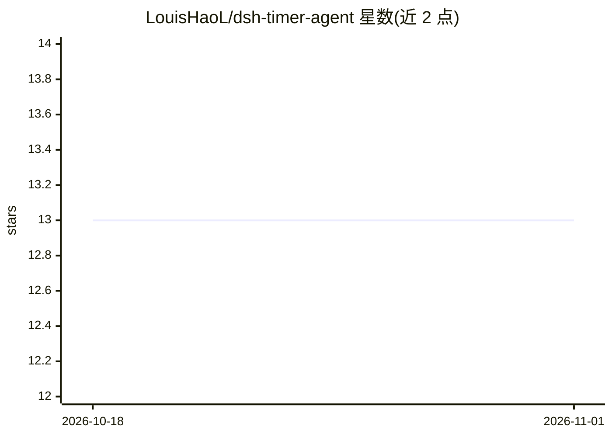

# LouisHaoL/dsh-timer-agent

⭐ 13 · TypeScript · MIT · 推送 2026-10-09 · [GitHub](https://github.com/LouisHaoL/dsh-timer-agent) · 个人维护 · 中文 README

**DSH 插件：cron 定时驱动真实 AI Agent 会话与命令任务**

DeepSeek Harness (DSH) Web GUI 的插件，在 dsh web 宿主进程内运行 60s ticker，实现 host 常驻定时任务引擎，GUI 关闭仍照常触发。任务分两类：AI Agent 任务到点经真实 agent 会话执行 prompt（可钉住会话保持上下文、或指定项目 workdir、或默认工作空间新建会话）；普通任务到点 spawn 执行命令，不经过 AI。提供 timer_agent 模型工具、Web 面板与 jobs.json 台账三个管理入口。限制：普通任务以当前用户权限执行任意命令、无沙箱；定时依赖 dsh web 进程存活；仅兼容 dsh 0.2.0-rc.2，开发验证环境为 Windows。

## 筛选速览

| 维度 | 判定 | 备注 |
|---|---|---|
| AI 角色 | `ai-ecosystem` | LLM/agent 周边工具 |
| 许可风险 | `permissive` | MIT |
| 部署形态 | `library` | 以包/库形式分发 |
| 模型依赖 | — | README 未给出锁定关系 |
| 硬件要求 | — | 无带数字的原话,不猜 |
| 安装摩擦 | `low` | 无编译、无系统依赖或容器化 |
| 成熟度 | — | 结构信号不足 |

## 能力要点

- 5 段 cron / 固定间隔 / 一次性三种执行模式，GUI 关闭仍常驻触发
- 三种目标定位：钉住已有会话 / 项目 workdir 新会话 / 默认工作空间
- timer_agent 工具、Web 面板、jobs.json 台账同源管理任务
- 普通命令任务不经过 AI、不消耗额度；at-most-once 调度不重复执行

## 适用场景

- 定时让 AI agent 在指定项目里执行自包含 prompt
- 定时跑脚本命令（下载、导出、续期等）并记录 stdout/stderr 与退出码
- 在对话中让 agent 用 timer_agent 工具创建管理定时任务

## 场景标签

`工作流自动化` · 领域:效率与自动化

## 证据(README 行号)

> L5: 一个 DeepSeek Harness (DSH) Web GUI 插件:调研 NousResearch/hermes-agent 的 cron 系统后,按其「定时器 ↔ Agent 协同」思路实现的 **host 常驻定时任务引擎
> L21: - **AI Agent 任务**(默认):到点驱动真实 agent 会话执行 prompt,消耗 API 额度

## 星数曲线

2026-10-18 13 → 2026-11-01 13（+0）

---
*卡片 v1 · prompt 1.4 · 生成 2026-10-31 · 置信度 mid · 依据 README sha `309860acb3b6` · [字段定义](../../DATASET.md)*
