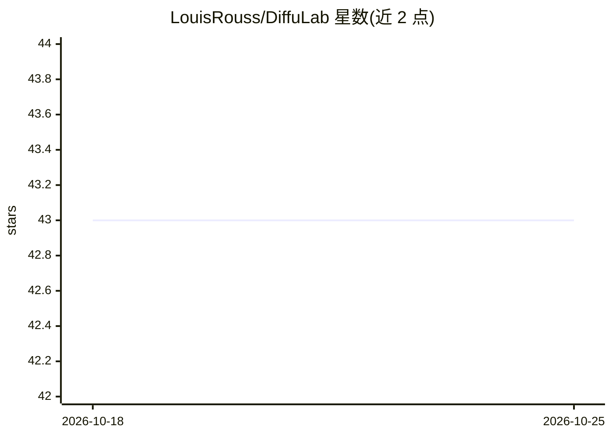

# LouisRouss/DiffuLab

⭐ 43 · Python · MIT · 推送 2026-01-11 · [GitHub](https://github.com/LouisRouss/DiffuLab) · 个人维护

**用于从零训练扩散模型的 PyTorch 库**

面向开发者的扩散模型训练库，围绕三个可定制模块组织：架构（U-Net、DiT）、形式化方法（Rectified Flow、DDPM 等）与推理采样器。支持 RePA 训练、混合精度、潜空间扩散（VAE）、梯度检查点、torch.compile、flash attention 等特性；训练通过 accelerate 启动。项目自述处于早期阶段，To-Do 中尚有 LoRA/DORA 微调、EDM、reflow 等未完成项，尚无单元测试 CI。

## 筛选速览

| 维度 | 判定 | 备注 |
|---|---|---|
| AI 角色 | `ai-ecosystem` | LLM/agent 周边工具 |
| 许可风险 | `permissive` | MIT |
| 部署形态 | `library` | 以包/库形式分发 |
| 模型依赖 | — | README 未给出锁定关系 |
| 硬件要求 | — | 无带数字的原话,不猜 |
| 安装摩擦 | `low` | 无编译、无系统依赖或容器化 |
| 成熟度 | `idea` | |

## 能力要点

- 架构/形式化/采样器三模块解耦，核心组件可定制
- 支持 U-Net 与 DiT 架构、Rectified Flow 与 DDPM 等形式化
- 支持混合精度、梯度检查点、torch.compile、flash attention
- 含 SPRINT、RePA 等训练方法

## 适用场景

- 从零训练自定义扩散/流匹配模型
- 替换或扩展扩散模型的架构与采样器做实验
- 研究 Rectified Flow、RePA、SPRINT 等训练方法

## 场景标签

`模型训练` `图像生成` · 领域:内容生成

## 证据(README 行号)

> L18: DiffuLab is designed to provide a simple and flexible way to train diffusion models while allowing full customizati
> L20: 1. **Architecture** (e.g., U-Net, DiT)
> L21: 2. **Formalization** (e.g., Rectified Flow, DDPM, EDM)

## 星数曲线

2026-10-18 43 → 2026-10-25 43（+0）

---
*卡片 v1 · prompt 1.4 · 生成 2026-10-25 · 置信度 mid · 依据 README sha `a238b87ff3eb` · [字段定义](../../DATASET.md)*
