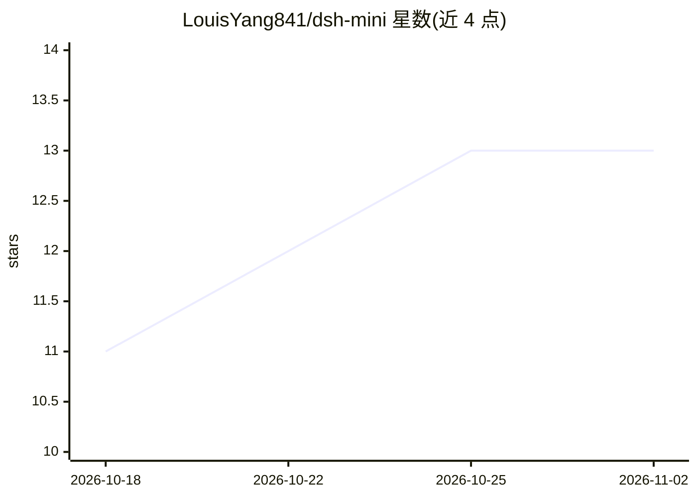

# LouisYang841/dsh-mini

⭐ 13 · JavaScript · MIT · 推送 2026-08-16 · [GitHub](https://github.com/LouisYang841/dsh-mini) · 个人维护 · 中文 README

**手机可跑的终端编程 Agent CLI + 可嵌入的 DSH 便携引擎**

以 npm 消费者身份将 pi 壳与 DeepSeek Harness（DSH）引擎组装成单文件 CLI：引擎（事件溯源会话、turn/step 状态机、工具调度、压缩、skills）来自官方包锁版直用，仓库自研部分为五条接缝（LLM 适配器、文件系统、持久化、Node shims、引擎 polyfills）与兼容层。面向在 Termux/Android 或普通终端上运行编程 agent 的用户：7.7MB 自包含文件、零运行时 npm 依赖，支持 DeepSeek/Gemini/OpenAI/Anthropic/OpenRouter 多 provider，bash 工具直接操作手机文件系统。另提供 419KB 便携引擎 bundle 与 conformance 基线供嵌入其他宿主。限制：推荐 Node ≥ 22.15（旧版会话退化为未压缩 JSONL）。

## 筛选速览

| 维度 | 判定 | 备注 |
|---|---|---|
| AI 角色 | `ai-native` | 本体是模型或模型工具 |
| 许可风险 | `permissive` | MIT |
| 部署形态 | `library` | 以包/库形式分发 |
| 模型依赖 | locked-api |  |
| 硬件要求 | — | 无带数字的原话,不猜 |
| 安装摩擦 | `low` | 无编译、无系统依赖或容器化 |
| 成熟度 | — | 结构信号不足 |

## 能力要点

- DSH 引擎锁版直用 + pi 生态壳，产物为 7.7MB 自包含单文件，零运行时 npm 依赖
- 五条接缝支持替换 provider/文件系统/持久化/UI，并附六步嵌入配方
- Termux/Android 实测可用，含 SELinux 与退出时序等平台修复
- conformance 门：假 provider 回放，Node 与 QuickJS 产生字节级一致事件序列

## 适用场景

- 在 Android 手机（Termux）上运行可操作真实文件系统的编程 agent
- 在桌面终端以 minimal/standard 模式做代码任务，多 provider 切换
- 把 DSH 核心作为便携引擎嵌入其他 harness/agent 应用

## 场景标签

`编码 Agent` · 领域:编码与开发

## 证据(README 行号)

> L11: **DeepSeek Harness 核心的便携引擎 + 一个能在手机上干活的终端编程 Agent CLI。** 我们不是 fork：以 npm 消费者身份把 pi（壳）和 DSH（引擎）拼在一起，本仓库真正自研的是**五条缝、兼
> L63: dsh-mini

## 星数曲线

2026-10-18 11 → 2026-11-02 13（+2）

---
*卡片 v1 · prompt 1.4 · 生成 2026-10-31 · 置信度 mid · 依据 README sha `e1384e20910c` · [字段定义](../../DATASET.md)*
