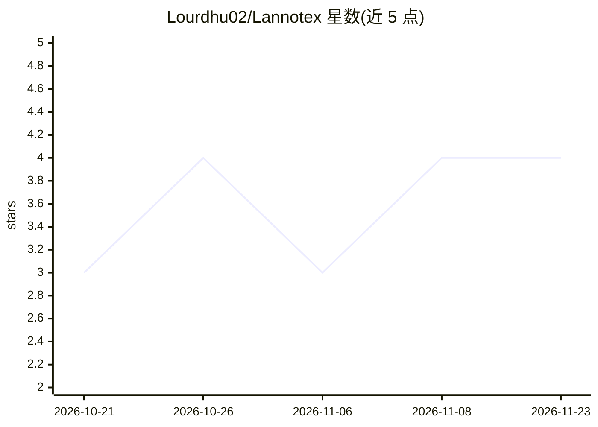

# Lourdhu02/Lannotex

⭐ 4 · Python · MIT · 推送 2026-11-01 · [GitHub](https://github.com/Lourdhu02/Lannotex) · [官网](https://lourdhu02.github.io/Lannotex/) · 个人维护

**面向 CV 数据标注者的离线桌面图像标注工具**

用于给图像打框、多边形和类别标签的桌面应用，产出用于训练计算机视觉模型的数据集。数据集存为单个 SQLite 文件，支持 JPEG/PNG/WebP/TIFF/BMP 原位引用导入；通过 tile pyramid 缓存与增量编辑使大图与密集标注保持可操作；250ms 恢复草稿、事务式保存与崩溃后可用的 undo 历史防数据丢失。导出 YOLO/COCO/VOC/LabelMe/CSV/JSONL 并可反向导入，CLI 可无显示环境运行；另提供可选的局域网团队审阅。不支持 SAM 辅助标注及点/线/旋转框等形状。

## 筛选速览

| 维度 | 判定 | 备注 |
|---|---|---|
| AI 角色 | `ai-ecosystem` | LLM/agent 周边工具 |
| 许可风险 | `permissive` | MIT |
| 部署形态 | `library` | 以包/库形式分发 |
| 模型依赖 | — | README 未给出锁定关系 |
| 硬件要求 | — | 无带数字的原话,不猜 |
| 安装摩擦 | `low` | 无编译、无系统依赖或容器化 |
| 成熟度 | — | 结构信号不足 |

## 能力要点

- 导出 YOLO、COCO、VOC、LabelMe、CSV、JSONL 并导入 COCO/YOLO/VOC/LabelMe
- 900 MP TIFF 经 tile pyramid 缓存后 98 ms 重新打开
- SQLite 单文件项目、250ms 恢复草稿与事务式保存
- headless CLI（export/import/analyze）可在 CI 中运行

## 适用场景

- 在自己的机器上标注目标检测与分割数据集
- 把已有的 LabelMe/COCO/YOLO 数据集导入后继续标注再导出
- 在 CI 流水线中用 analyze 校验数据集健康度

## 场景标签

 · 领域:计算机视觉/数据标注工具

## 证据(README 行号)

> L23: Lannotex is a desktop app for labelling images to train computer-vision models. It keeps your
> L96: ## Export to what your model expects
> L112: Also exports **Pascal VOC**, **COCO JSON**, **YOLO segments**, **LabelMe JSON**,

## 星数曲线

2026-10-21 3 → 2026-11-23 4（+1）

---
*卡片 v1 · prompt 1.4 · 生成 2026-11-21 · 置信度 high · 依据 README sha `f8a857837910` · [字段定义](../../DATASET.md)*
