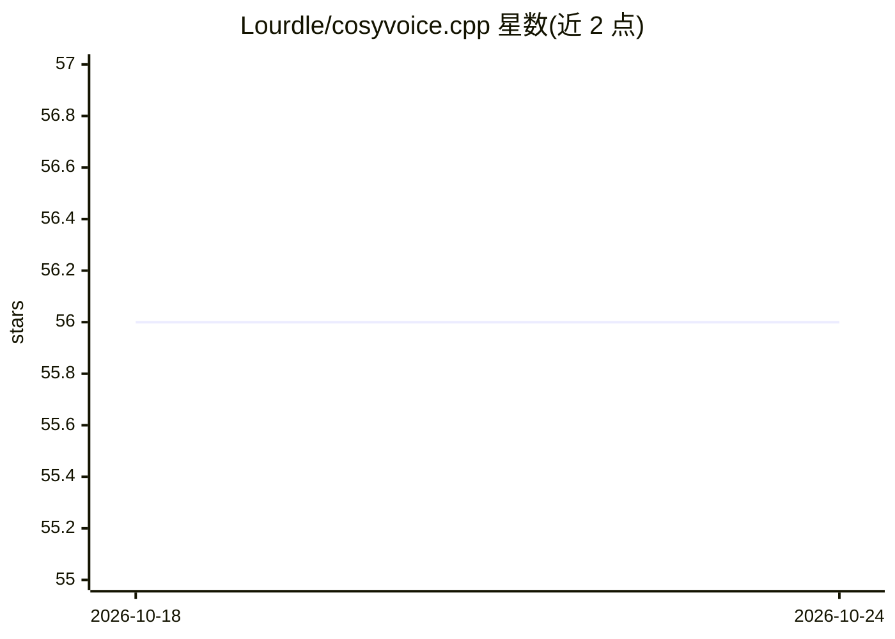

# Lourdle/cosyvoice.cpp

⭐ 56 · C++ · MIT · 推送 2026-10-23 · [GitHub](https://github.com/Lourdle/cosyvoice.cpp) · 个人维护 · 中文 README

**CosyVoice3 语音合成的 C++/GGML 本地推理工具链**

由独立开发者维护的社区项目，将 Python 版 CosyVoice 推理流程移植为 C/C++，当前聚焦 CosyVoice3，支持 zero-shot、instruct、跨语言三种 TTS 模式及流式输出。提供核心推理库、CLI 合成工具、OpenAI Speech 兼容 API 服务器（内嵌 WebUI）与 GGUF 量化工具。运行依赖 llama.cpp 发布的 GGML 库，支持 CPU/CUDA/Metal/Vulkan/SYCL 后端。提供预编译产物与源码构建两条路径；README 提示部分后端需在生产使用前查阅测试状态，且预编译 GGML CUDA 后端存在已知噪声问题。

## 筛选速览

| 维度 | 判定 | 备注 |
|---|---|---|
| AI 角色 | `ai-native` | 本体是模型或模型工具 |
| 许可风险 | `permissive` | MIT |
| 部署形态 | `desktop` | 安装包/桌面程序 |
| 模型依赖 | local-ok | 支持本地模型 |
| 硬件要求 | — | 无带数字的原话,不猜 |
| 安装摩擦 | `high` | 编译与系统依赖俱全 |
| 成熟度 | `idea` | |

## 能力要点

- OpenAI Speech 兼容 API 服务器（/v1/audio/speech）与内嵌 WebUI
- zero-shot / instruct / 跨语言三种 TTS 模式，支持流式低延迟输出
- GGUF 量化工具（Q2_K–F16），含按张量映射的量化类型配置
- CPU/CUDA/Metal/Vulkan/SYCL 多后端与自适应 SIMD 分发

## 适用场景

- 在本地 CPU 或 GPU 上离线运行 CosyVoice3 语音合成
- 以 OpenAI Speech 兼容 API 形式对外提供 TTS 服务
- 将 CosyVoice3 模型量化为更小的 GGUF 格式部署

## 场景标签

`语音合成` `推理引擎` `模型量化` · 领域:内容生成

## 证据(README 行号)

> L14: C++/GGML port of the Python CosyVoice inference pipeline, currently focused on **CosyVoice3**.
> L16: Supports **zero-shot**, **instruct**, and **cross-lingual** TTS modes with both synchronous and **streaming** outpu

## 星数曲线

2026-10-18 56 → 2026-10-24 56（+0）

---
*卡片 v1 · prompt 1.4 · 生成 2026-10-24 · 置信度 mid · 依据 README sha `b2ef264515bb` · [字段定义](../../DATASET.md)*
