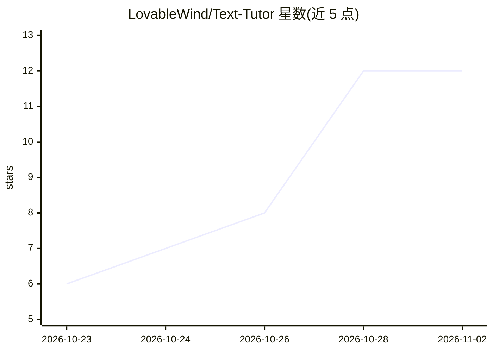

# LovableWind/Text-Tutor

⭐ 12 · Python · MIT · 推送 2026-10-25 · [GitHub](https://github.com/LovableWind/Text-Tutor) · 个人维护 · 中文 README

**讲义伴读桌面工具：选中句子只讲解已学内容，习题只给提示**

面向学生的 Windows/macOS 桌面工具：导入整学期 PDF/PPT/PPTX 课件并按讲次排序，在 PDF 阅读器旁开侧窗讲解选中句子。核心机制是跟踪当前讲次页码，超出进度的内容标「⏭ 引申」、讲义没有的标「➕ 补充」，模型生成后还有一层边界自查重写；习题按翻译/提示/讲解分级，答案分层给出。默认接 DeepSeek API，也可填任意 OpenAI 兼容接口（智谱、硅基流动、本地 Ollama）。解压即用，需自备 API Key。macOS 缺全局热键且不带 Python 运行时。

## 筛选速览

| 维度 | 判定 | 备注 |
|---|---|---|
| AI 角色 | `ai-native` | 本体是模型或模型工具 |
| 许可风险 | `permissive` | MIT |
| 部署形态 | `desktop` | 安装包/桌面程序 |
| 模型依赖 | local-ok | 支持本地模型 |
| 硬件要求 | — | 无带数字的原话,不猜 |
| 安装摩擦 | `low` | 无编译、无系统依赖或容器化 |
| 成熟度 | — | 结构信号不足 |

## 能力要点

- 按「已讲范围」（当前讲次页码之前）约束讲解内容，越界标 ⏭/➕ 并自动重写
- 习题三选项分级（只翻译/给提示/讲解），提示分层且答案留白
- 整学期 PPTX/PPT/PDF 导入，自动按讲次排序并读取 PPTX 备注页
- 支持任意 OpenAI 兼容接口，含本地 Ollama 离线使用

## 适用场景

- 读数学/人文讲义卡住时，选中一句话获得只用已学内容的讲解
- 做习题时逐层要提示而不直接看答案
- 用本地 Ollama 离线完成讲义伴读

## 场景标签

`文档问答` · 领域:知识与检索

## 证据(README 行号)

> L3: **选中讲义里的一句话，侧边窗口只讲你已经学过的部分。**
> L5: 读讲义卡住时，通用 AI 会把最漂亮的解法给你——包括你还没学的。旁批知道你读到第几讲第几页：超出进度的内容必须标出来源，讲义里没有的必须说明是补充。
> L32: |不知道你学过什么|知道你读到第几讲第几页|
> L65: 选中一道题（有没有"习题"两个字都认——看的是句式：祈使动词、问句、选项、填空），先出三个按钮：

## 星数曲线

2026-10-23 6 → 2026-11-02 12（+6）

---
*卡片 v1 · prompt 1.4 · 生成 2026-11-01 · 置信度 high · 依据 README sha `2f53748e1630` · [字段定义](../../DATASET.md)*
