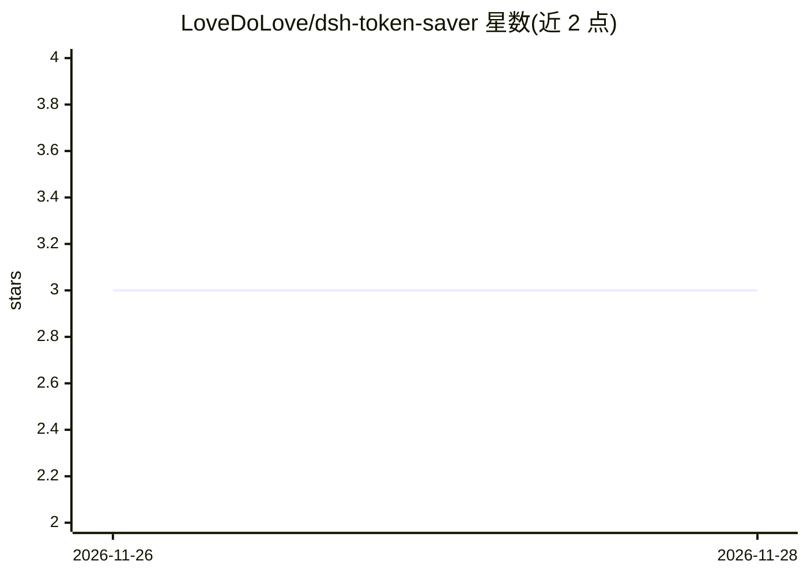

# LoveDoLove/dsh-token-saver

⭐ 3 · TypeScript · MIT · 推送 2026-11-16 · [GitHub](https://github.com/LoveDoLove/dsh-token-saver) · [官网](https://github.com/LoveDoLove/dsh-token-saver) · 个人维护 · 中文 README

**DSH 插件：裁剪工具输出以节省上下文 token**

面向 DeepSeek Harness（DSH）的插件，在工具执行边界处理超长输出：保留长结果首尾、将 grep 结果折叠为匹配项、可选 RTK 形状感知压缩，并提供可选的提示风格塑造（Caveman/Ponytail）与本地探测响应。所有策略失败时回退到原始结果，不改动用户与助手消息。以 dsh plugin 命令安装，配置位于 DSH profile 的 bundle 行，含 22 个配置项与 Web 面板。

## 筛选速览

| 维度 | 判定 | 备注 |
|---|---|---|
| AI 角色 | `ai-ecosystem` | LLM/agent 周边工具 |
| 许可风险 | `permissive` | MIT |
| 部署形态 | `library` | 以包/库形式分发 |
| 模型依赖 | — | README 未给出锁定关系 |
| 硬件要求 | — | 无带数字的原话,不猜 |
| 安装摩擦 | `low` | 无编译、无系统依赖或容器化 |
| 成熟度 | — | 结构信号不足 |

## 能力要点

- 工具输出首尾保留裁剪与 grep 结果折叠（默认开启）
- RTK 形状感知压缩：diff、日志、目录树、表格（默认关闭）
- 本地响应探测零用量应答，frozen LLM 请求不被改写
- 全部策略 fail-open，错误输出永不压缩

## 适用场景

- 长会话中减少工具输出占用上下文窗口
- 控制 grep、构建日志等大体积结果的保留方式
- 通过 Web 面板查看压缩节省量并实时调整配置

## 场景标签

`提示工程` · 领域:Agent 开发

## 证据(README 行号)

> L6: A DeepSeek Harness plugin that trims oversized tool output, folds grep results,
> L17: Token Saver works at the DSH tool-execution boundary. It keeps the head and tail
> L128: Targets DSH `>=0.2.0 <0.3.0` and Node `>=22.19.0`. Works alongside Billion

## 星数曲线

2026-11-26 3 → 2026-11-28 3（+0）

---
*卡片 v1 · prompt 1.4 · 生成 2026-11-26 · 置信度 mid · 依据 README sha `9357ac8779e1` · [字段定义](../../DATASET.md)*
