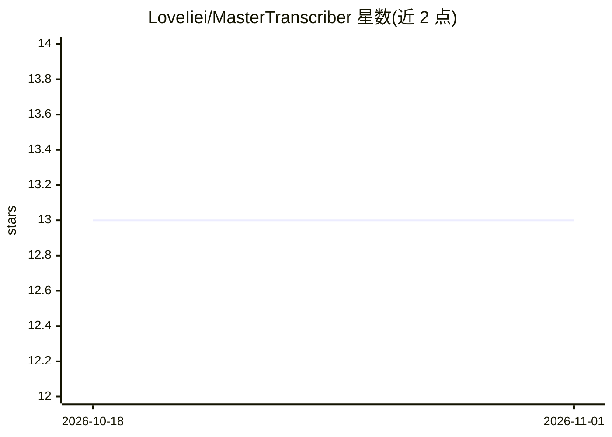

# LoveIiei/MasterTranscriber

⭐ 13 · C# · 推送 2025-11-06 · [GitHub](https://github.com/LoveIiei/MasterTranscriber) · 个人维护

**Windows 桌面应用：录音并实时转写、翻译、AI 总结会议与课程**

基于 .NET 8.0 / WPF 的 Windows 桌面应用，面向需要记录会议和课程的个人用户：同时捕获系统音频与麦克风，支持实时转写（5-300 秒可配置间隔）、视频/音频文件转写、AI 生成摘要与行动项，以及通过 DeepL 翻译为 8 种以上语言。转写与总结可分别选择本地模型（Whisper.cpp、Ollama）或云端 API（Azure STT、OpenRouter），也支持混合模式。安装方式为下载 Release 压缩包运行 exe，开发者可从源码构建；本地模式需自行安装 Whisper.cpp 与 Ollama。

## 筛选速览

| 维度 | 判定 | 备注 |
|---|---|---|
| AI 角色 | `ai-native` | 本体是模型或模型工具 |
| 许可风险 | `none` | — |
| 部署形态 | `desktop` | 安装包/桌面程序 |
| 模型依赖 | local-ok | 支持本地模型 |
| 硬件要求 | — | 无带数字的原话,不猜 |
| 安装摩擦 | `medium` | 含编译或系统依赖之一 |
| 成熟度 | — | 结构信号不足 |

## 能力要点

- 实时转写，间隔 5-300 秒可配置
- 本地（Whisper.cpp/Ollama）与云端（Azure/OpenRouter）可混合配置
- DeepL 多语言翻译（支持 8 种以上语言）
- AI 摘要含重点与行动项，长录音自动分块处理

## 适用场景

- 会议或上课时录音并生成带行动项的总结
- 将录音或视频快速转成文字稿并翻译成其他语言
- 使用本地模型离线转写，不把录音发送到云端

## 场景标签

`语音识别` · 领域:感知与多模态

## 证据(README 行号)

> L3: A powerful Windows desktop application for recording, transcribing, and summarizing meetings and lectures with AI. B
> L14: - **Real-Time Transcription**: See transcripts appear live as you speak (configurable 5-300 second intervals)
> L22: - **Local or Cloud**: Choose between local models (Whisper.cpp, Ollama) or cloud APIs (Azure STT, OpenRouter)

## 星数曲线

2026-10-18 13 → 2026-11-01 13（+0）

---
*卡片 v1 · prompt 1.4 · 生成 2026-10-31 · 置信度 high · 依据 README sha `bf5000a84aa0` · [字段定义](../../DATASET.md)*
