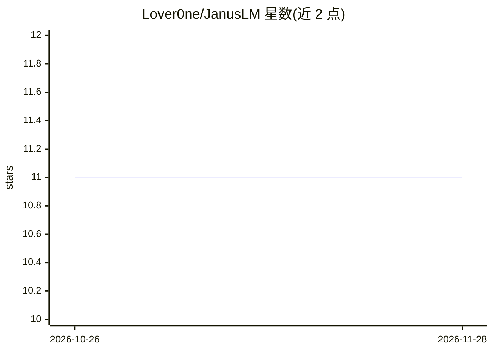

# Lover0ne/JanusLM

⭐ 11 · Python · MIT · 推送 2026-04-30 · [GitHub](https://github.com/Lover0ne/JanusLM) · 个人维护

**基于编码 Agent 的多项目知识库助手：读文档入库并回答问题**

JanusLM 将任意 AI 编码代理改造成带有结构化多项目知识库的通用助手，基于 Andrej Karpathy 的 LLM Wiki 概念：文档经 ingest 管道分解为来源、实体、概念与综述页面，维护索引与知识图谱。其定位为「确定性辅助的代理系统」，Python 工具负责结构与校验，代理负责阅读与关联；采用盲审模式让代理推理与确定性分析独立运行以避免锚定。支持多项目隔离查询、自愈修复、安全锁删除、操作日志。首次使用自动安装 Python 依赖；wiki 目录可直接作为 Obsidian vault 使用。

## 筛选速览

| 维度 | 判定 | 备注 |
|---|---|---|
| AI 角色 | `ai-native` | 本体是模型或模型工具 |
| 许可风险 | `permissive` | MIT |
| 部署形态 | `library` | 以包/库形式分发 |
| 模型依赖 | — | README 未给出锁定关系 |
| 硬件要求 | — | 无带数字的原话,不猜 |
| 安装摩擦 | `low` | 无编译、无系统依赖或容器化 |
| 成熟度 | — | 结构信号不足 |

## 能力要点

- 多代理指令文件适配 Claude Code/Codex/Gemini/Cursor/Cline
- 确定性 Python 工具与代理推理结合的盲审（Blind Review）模式
- 可中断续跑的 ingest 队列与 heal 状态机
- wikilinks 页面直接兼容 Obsidian vault 与 Dataview

## 适用场景

- 把论文、报告、表格批量入库为可交叉引用的个人 wiki
- 按项目隔离提问，检查知识库中的矛盾与缺失链接
- 让代理在知识库之上写 Word 报告、幻灯片或做数据分析

## 场景标签

`知识库管理` `知识图谱` `文档问答` `数据分析` · 领域:效率与自动化

## 证据(README 行号)

> L11: JanusLM turns any AI coding agent into a general-purpose assistant backed by a structured, multi-project knowledge 
> L13: It builds on the **LLM Wiki** concept by Andrej Karpathy — a knowledge management system fully maintained by an AI 
> L94: JanusLM is multi-agent by design, optimized for Claude but it works with any coding agent that can read markdown in

## 星数曲线

2026-10-26 11 → 2026-11-28 11（+0）

---
*卡片 v1 · prompt 1.4 · 生成 2026-11-19 · 置信度 mid · 依据 README sha `776d216fe6c6` · [字段定义](../../DATASET.md)*
