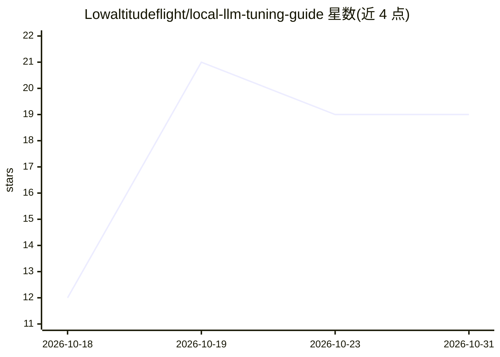

# Lowaltitudeflight/local-llm-tuning-guide

⭐ 19 · Python · MIT · 推送 2026-10-27 · [GitHub](https://github.com/Lowaltitudeflight/local-llm-tuning-guide) · 个人维护 · 中文 README

**无 NVLink 多 GPU 本地 LLM 部署的决策库，结论均带证据分级**

面向在无 NVLink 机器（RTX 4090/5090、RTX PRO 6000、PCIe 版数据中心卡）上自托管 LLM 推理的运维与部署人员：提供并行策略（TP/PP/副本）、通信、量化、投机解码、KV cache 等决策结论，每条标注证据分级（Measured/Derivable/Open）与适用条件。附 planner.py 工具，根据 GPU 型号、数量、模型与上下文长度报告互连上限、显存预算与并行布局建议。项目声明不编造数据，空缺单元格保留待实测填充。

## 筛选速览

| 维度 | 判定 | 备注 |
|---|---|---|
| AI 角色 | `ai-knowledge` | 知识聚合/清单类 |
| 许可风险 | `permissive` | MIT |
| 部署形态 | `None` |  |
| 模型依赖 | — | README 未给出锁定关系 |
| 硬件要求 | — | 无带数字的原话,不猜 |
| 安装摩擦 | `low` | 无编译、无系统依赖或容器化 |
| 成熟度 | — | 结构信号不足 |

## 能力要点

- 每个结论携带证据分级（Measured/Derivable/Open）与适用条件
- planner.py 按拓扑生成 TP/PP/副本布局建议
- 六条高置信结论覆盖并行、量化、投机解码决策
- 明确定位无 NVLink 的 PCIe 互连场景

## 适用场景

- 部署新多 GPU 机器时选择张量并行/流水线并行配置
- 排查推理吞吐低于预期时对照参数差异
- 为私有化 LLM 部署决策查找带条件约束的依据

## 场景标签

`精选清单` · 领域:学习与行业

## 证据(README 行号)

> L8: **A decision library for multi-GPU deployments without NVLink.**
> L10: Not an explanation of theory — a set of decisions, each tagged with its source and the conditions under which it ho
> L41: Every conclusion carries a basis tag:

## 星数曲线

2026-10-18 12 → 2026-10-31 19（+7）

---
*卡片 v1 · prompt 1.4 · 生成 2026-10-29 · 置信度 high · 依据 README sha `62e4cbde3370` · [字段定义](../../DATASET.md)*
