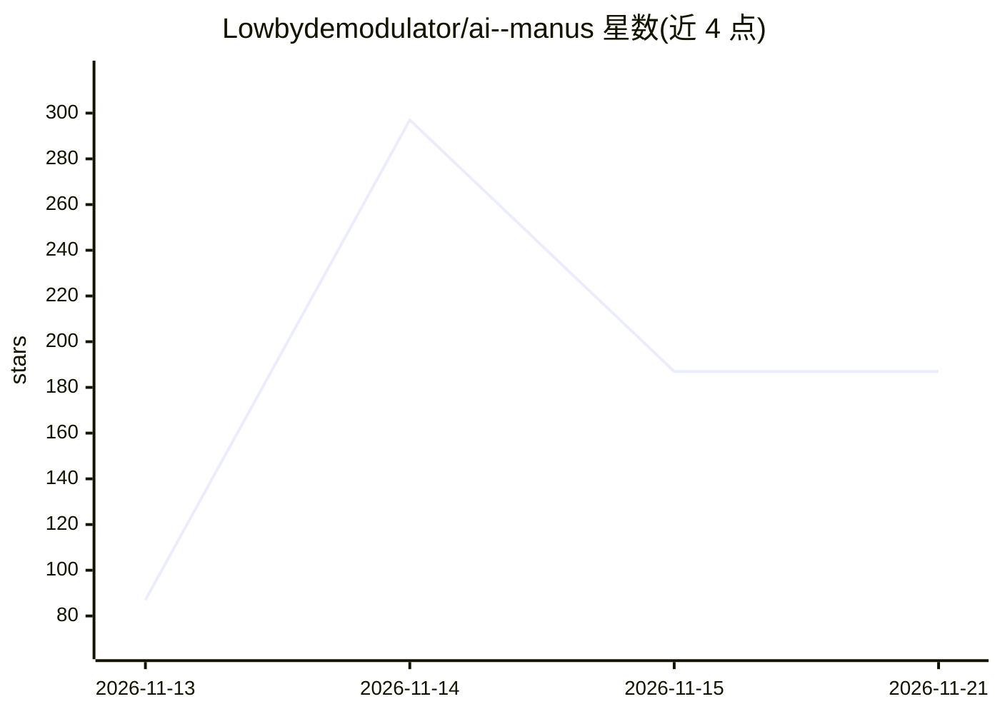

# Lowbydemodulator/ai--manus

⭐ 187 · Apache-2.0 · 推送 2026-11-15 · [GitHub](https://github.com/Lowbydemodulator/ai--manus) · 个人维护

**自主 AI Agent：代用户执行代码与控制浏览器完成多步任务**

面向家庭、学习与轻量办公场景的自主 AI 代理，用户以自然语言描述需求，代理自行规划步骤：编写并执行脚本、打开网页、填写表单、跨脚本与浏览器完成多步任务，无需用户掌握完整编程技术。README 描述其可在后台常驻、跨会话保持任务模式，并给出硬件兼容表（最低双核 CPU、4GB 内存）。注意：README 未提供实际的安装命令、代码或下载渠道，仅含 'Download Manus' 与促销码 'PROMO2026' 字样，无技术实现细节。

## 筛选速览

| 维度 | 判定 | 备注 |
|---|---|---|
| AI 角色 | `ai-native` | 本体是模型或模型工具 |
| 许可风险 | `permissive` | Apache-2.0 |
| 部署形态 | `None` |  |
| 模型依赖 | — | README 未给出锁定关系 |
| 硬件要求 | — | 无带数字的原话,不猜 |
| 安装摩擦 | `low` | 无编译、无系统依赖或容器化 |
| 成熟度 | — | 结构信号不足 |

## 能力要点

- 自主执行代码与脚本完成多步任务
- 浏览器控制：导航网页、填写表单、收集信息
- 脚本与浏览器操作可在同一任务流程中衔接
- 跨会话记忆任务模式，后台常驻响应

## 适用场景

- 让代理代为收集多网页资料并整理摘要
- 自动填写重复表单或检查网页更新
- 运行小脚本做快速计算与实验
- 远程支持中整理诊断步骤与检查系统页面

## 场景标签

`浏览器自动化` · 领域:效率与自动化

## 证据(README 行号)

> L18: Manus is an autonomous AI agent designed to run code and control a browser on your behalf. Instead of acting like a
> L10: - **Autonomous Code Execution:** Manus AI agent runs code on its own to complete tasks, so you can focus on decisio

## 星数曲线

2026-11-13 87 → 2026-11-21 187（+100）

---
*卡片 v1 · prompt 1.4 · 生成 2026-11-17 · 置信度 low · 依据 README sha `0f78ee3a5dd2` · [字段定义](../../DATASET.md)*
