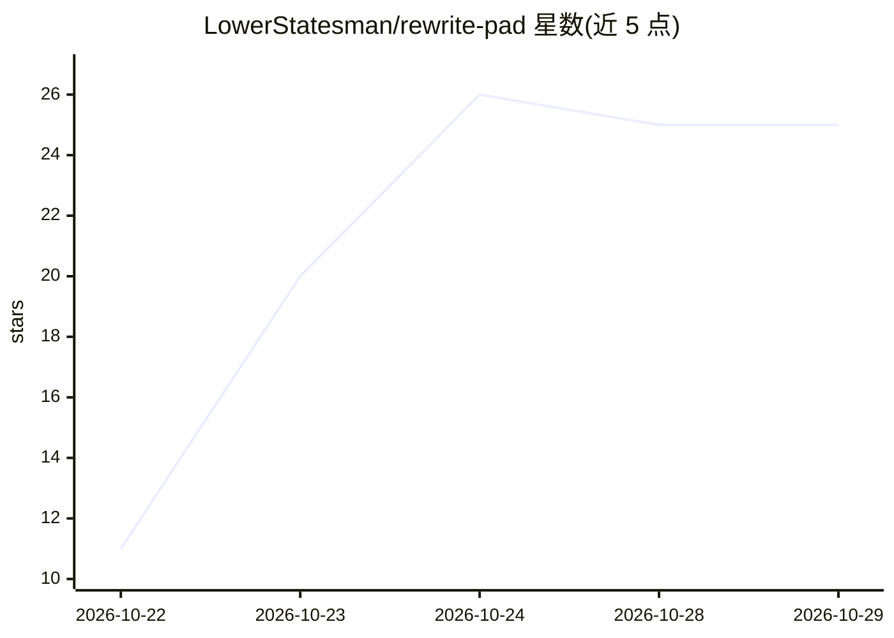

# LowerStatesman/rewrite-pad

⭐ 25 · C# · MIT · 推送 2026-10-18 · [GitHub](https://github.com/LowerStatesman/rewrite-pad) · 个人维护

**Windows 离线文本改写工作台：本地 LLM 加持的缩短/正式化/简化工具**

面向 Windows 10/11 x64 的便携文本改写应用：内置缩短、正式化、简化、扩写、语法修复等操作按钮，通过连接任意本地 llama.cpp 服务器执行改写；改写结果以行内 diff 呈现，可按 hunk 逐段接受。支持快捷键剪贴板往返、语气预设、自定义风格规则与可搜索的项目历史。以约 100 MB 自包含单文件 exe 发布，运行时打包、离线运行、无遥测，MIT 许可并附 SHA-256 校验；也可用 .NET 8 SDK 从源码构建。

## 筛选速览

| 维度 | 判定 | 备注 |
|---|---|---|
| AI 角色 | `ai-native` | 本体是模型或模型工具 |
| 许可风险 | `permissive` | MIT |
| 部署形态 | `None` |  |
| 模型依赖 | — | README 未给出锁定关系 |
| 硬件要求 | — | 无带数字的原话,不猜 |
| 安装摩擦 | `medium` | 含编译或系统依赖之一 |
| 成熟度 | — | 结构信号不足 |

## 能力要点

- 改写操作对接任意本地 llama.cpp 服务器，文本不出本地
- 行内 diff 逐 hunk 审阅接受，而非整段覆盖
- 快捷键剪贴板往返：取选区→改写→写回
- 约 100 MB 自包含便携 exe，离线运行，发布附 SHA-256 校验

## 适用场景

- 离线改写敏感文本，不依赖云端上传
- 逐段审阅 AI 改写结果后选择性采纳
- 用固定语气预设与自定义风格规则批量润色文档

## 场景标签

`AI 写作` · 领域:内容生成

## 证据(README 行号)

> L3: ✏️ Free, open-source text rewriting workbench for Windows — shorten, formalize, simplify with a local LLM. 100 MB po
> L11: - ✅ **Action buttons** — shorten, formalize, simplify, expand and fix grammar run against any local llama.cpp serve

## 星数曲线

2026-10-22 11 → 2026-10-29 25（+14）

---
*卡片 v1 · prompt 1.4 · 生成 2026-10-26 · 置信度 high · 依据 README sha `a661f34531c9` · [字段定义](../../DATASET.md)*
