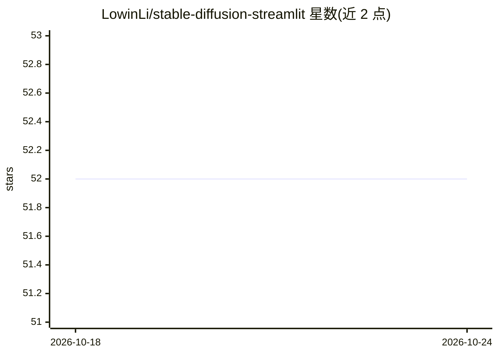

# LowinLi/stable-diffusion-streamlit

⭐ 52 · Python · NOASSERTION · 推送 2026-02-07 · [GitHub](https://github.com/LowinLi/stable-diffusion-streamlit) · 个人维护 · 中文 README

**量化版 Stable Diffusion 文生图 Web 应用，内存占用降 75%**

将 CompVis/stable-diffusion-v1-4 用 OnnxRuntime 量化（UINT8）后，以 Streamlit Web 应用形式提供文本生成图片测试：用户粘贴 prompt、设置运行参数、点击生成，通过进度条查看 pipeline 进度，画廊页查看历史图片。量化模型显存/内存占用从 5.2GB 降至 1.3GB，可在多数家用电脑 CPU 上运行。以 docker-compose 部署，量化在 docker 镜像构建阶段完成。To Do 中列出图生图与局部重绘 pipeline 尚未实现。

## 筛选速览

| 维度 | 判定 | 备注 |
|---|---|---|
| AI 角色 | `ai-native` | 本体是模型或模型工具 |
| 许可风险 | `none` | NOASSERTION |
| 部署形态 | `self-host` | docker 或自建部署 |
| 模型依赖 | — | README 未给出锁定关系 |
| 硬件要求 | — | 无带数字的原话,不猜 |
| 安装摩擦 | `low` | 无编译、无系统依赖或容器化 |
| 成熟度 | — | 结构信号不足 |

## 能力要点

- OnnxRuntime UINT8 量化使内存占用降至 1.3GB（原 PyTorch 5.2GB）
- Streamlit Web 界面：文本转图片、参数调整、画廊浏览
- 生成过程带进度条（Python 线程更新）
- docker-compose 一键部署，量化在镜像构建时完成

## 适用场景

- 在普通家用电脑 CPU 上运行 Stable Diffusion 文生图
- 通过网页界面用 prompt 快速生成与测试图片
- 低内存环境部署文生图演示应用

## 场景标签

`图像生成` · 领域:内容生成

## 证据(README 行号)

> L9: + Create beautiful apps using Streamlit to test CompVis/stable-diffusion-v1-4 model quantized by OnnxRuntime **cutti
> L13:  + a latent text-to-image diffusion model capable of generating photo-realistic images given any text input.

## 星数曲线

2026-10-18 52 → 2026-10-24 52（+0）

---
*卡片 v1 · prompt 1.4 · 生成 2026-10-24 · 置信度 high · 依据 README sha `d6b8539ca776` · [字段定义](../../DATASET.md)*
