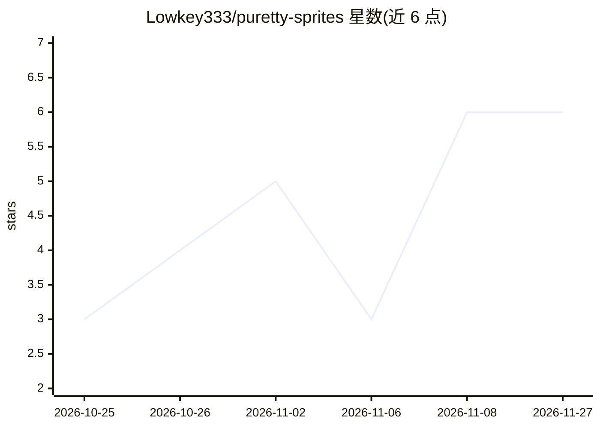

# Lowkey333/puretty-sprites

⭐ 6 · Python · NOASSERTION · 推送 2026-10-18 · [GitHub](https://github.com/Lowkey333/puretty-sprites) · 个人维护

**让 AI agent 制作像素画精灵的 LibreSprite MCP 服务器工具集**

围绕 LibreSprite 的 MCP 服务器工具集：由 aseprite-mcp 移植而来，包含像素化、Blender、ComfyUI、Krita 在内的 143 个工具，通过 Claude Code 等自然语言驱动。覆盖两条管线：ComfyUI+Krita 生成概念图后像素化；或经 TRELLIS.2 生成 3D 模型、自动绑骨渲染 1-16 方向帧。所有生成结果经背景去除、真实像素网格与小调色板清理。服务器直接读写 .ase 文件，带 158 个测试。生成工具仅靠 uv 即可运行，其余工具需对应目标软件。

## 筛选速览

| 维度 | 判定 | 备注 |
|---|---|---|
| AI 角色 | `ai-ecosystem` | LLM/agent 周边工具 |
| 许可风险 | `none` | NOASSERTION |
| 部署形态 | `desktop` | 安装包/桌面程序 |
| 模型依赖 | — | README 未给出锁定关系 |
| 硬件要求 | — | 无带数字的原话,不猜 |
| 安装摩擦 | `low` | 无编译、无系统依赖或容器化 |
| 成熟度 | — | 结构信号不足 |

## 能力要点

- MCP 服务器含 143 个工具（像素化、Blender、ComfyUI、Krita）
- 直接读写 LibreSprite .ase 文件，移植其 16 种混合模式渲染数学
- blender_auto_rig 自动绑骨并生成 8 个动画，可接 Mixamo/CMU 动捕
- 自带 158 个测试，部分依赖目标软件运行时跳过

## 适用场景

- 用自然语言生成带调色板与帧动画的像素精灵
- 把概念图经 ComfyUI 像素化并整理进 .ase 文件
- 从单个 3D 模型渲染多方向一致的行走动画帧
- 把 Mixamo/CMU 动捕贴到自动生成的角色骨架上

## 场景标签

`图像生成` · 领域:内容生成

## 证据(README 行号)

> L3: A toolkit for making pixel-art sprites with an AI agent, built around LibreSprite. It started from aseprite-mcp and 
> L12: |`libresprite-mcp/`|The MCP server: aseprite-mcp ported to LibreSprite, plus pixelization, Blender, ComfyUI and Kri
> L39: 1. Start Claude Code in this folder. It reads `.mcp.json` and asks to enable two servers: **libresprite** (this pro

## 星数曲线

2026-10-25 3 → 2026-11-27 6（+3）

---
*卡片 v1 · prompt 1.4 · 生成 2026-11-20 · 置信度 high · 依据 README sha `ad174076cc7f` · [字段定义](../../DATASET.md)*
