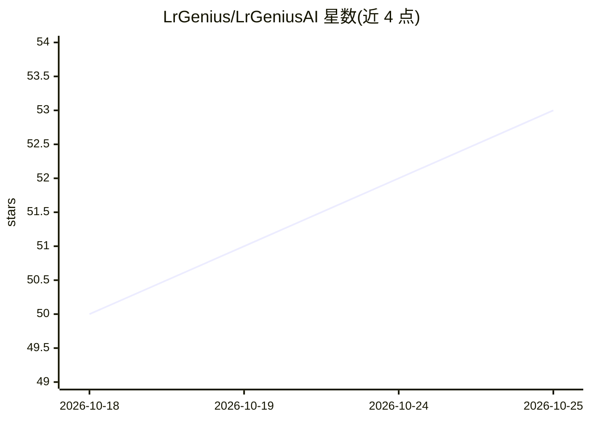

# LrGenius/LrGeniusAI

⭐ 53 · Rust · AGPL-3.0 · 推送 2026-10-24 · [GitHub](https://github.com/LrGenius/LrGeniusAI) · [官网](https://lrgenius.com) · 个人维护

**Lightroom Classic 的 AI 插件：打标、描述、语义搜索与照片管理**

Adobe Lightroom Classic 插件加 Rust 后端服务（geniusai-server），功能包括 AI 打标与描述生成、语义自然语言搜索、照片筛选、人脸检测聚类、基于 BioCLIP 2 的本地物种识别、相似图查找，以及从用户自己保存的编辑中插值生成 develop 编辑方案（非 LLM，需至少五个训练样本）。支持本地模型（内置 MLX/llama.cpp、Ollama、LM Studio）与云端 API（OpenAI、Gemini、Claude 等），并提供 MCP agent 桥接。注意：会写入目录元数据且不可回退，首次使用前需备份目录。

## 筛选速览

| 维度 | 判定 | 备注 |
|---|---|---|
| AI 角色 | `ai-enhanced` | 去掉 AI 部分产品仍成立 |
| 许可风险 | `viral` | AGPL-3.0 |
| 部署形态 | `desktop` | 安装包/桌面程序 |
| 模型依赖 | local-ok | 支持本地模型 |
| 硬件要求 | — | 无带数字的原话,不猜 |
| 安装摩擦 | `low` | 无编译、无系统依赖或容器化 |
| 成熟度 | `idea` | |

## 能力要点

- AI 打标、描述生成与语义自然语言搜索
- 内置本地推理：macOS 用 MLX，Windows 用 llama.cpp（Vulkan）
- BioCLIP 2 本地物种识别与人脸检测聚类
- MCP agent 桥接：AI 助手可在 Lightroom 中查找、评分、编辑照片

## 适用场景

- 给照片库批量生成标签、描述并做语义搜索
- 在本地运行视觉模型以保护照片隐私
- 让 AI 助手通过 MCP 代为管理我的 Lightroom 目录
- 整理连拍组并自动挑选最佳照片

## 场景标签

`语义搜索` `人脸识别` `目标检测` · 领域:知识与检索

## 证据(README 行号)

> L13: **LrGeniusAI** brings the power of modern Large Language Models (LLMs) directly into Adobe Lightroom Classic. It an
> L2:  A smart Lightroom Classic plugin for AI-powered tagging, describing, semantic search, and develop edits.
> L79: - **Frontend / Lightroom Plugin:** Lua (Lightroom SDK)

## 星数曲线

2026-10-18 50 → 2026-10-25 53（+3）

---
*卡片 v1 · prompt 1.4 · 生成 2026-10-24 · 置信度 high · 依据 README sha `ff393f95e702` · [字段定义](../../DATASET.md)*
