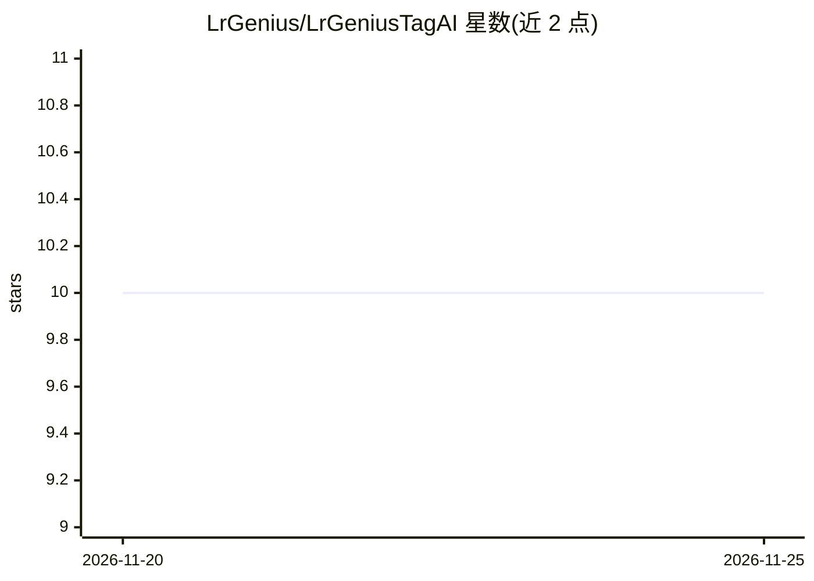

# LrGenius/LrGeniusTagAI

⭐ 10 · Lua · 推送 2026-09-06 · [GitHub](https://github.com/LrGenius/LrGeniusTagAI) · [官网](https://lrgenius.com) · 个人维护

**给 Lightroom Classic 用户用视觉模型自动生成照片标题、说明与关键词的插件**

Lightroom Classic 插件，在 Library 网格或导出流程中批量调用视觉模型，为照片生成标题、说明、替代文本与关键词并写回目录元数据。支持 Google Gemini、ChatGPT 云端 API 及本地 Ollama、LM Studio 四种接入方式；可自定义提示词预设、关键词层级分类、输出语言（英/德/法/西/意），提供保存前审核对话框、批量前预检与 token/费用估算、调试日志与性能 CSV 记录。需要 Lightroom Classic 11（SDK 11.0+），以 .lrdevplugin 形式安装。

## 筛选速览

| 维度 | 判定 | 备注 |
|---|---|---|
| AI 角色 | `ai-native` | 本体是模型或模型工具 |
| 许可风险 | `none` | — |
| 部署形态 | `desktop` | 安装包/桌面程序 |
| 模型依赖 | local-ok | 支持本地模型 |
| 硬件要求 | — | 无带数字的原话,不猜 |
| 安装摩擦 | `low` | 无编译、无系统依赖或容器化 |
| 成熟度 | — | 结构信号不足 |

## 能力要点

- 批量生成标题/说明/替代文本/关键词并写回 Lightroom 元数据
- 四种 provider：Gemini API、OpenAI API、本地 Ollama、本地 LM Studio
- 自定义提示词预设与关键词层级分类，多语言输出
- 保存前审核对话框与预检/费用估算流程

## 适用场景

- 批量给图库照片补齐关键词和 alt 文本
- 导出流程中自动生成图片说明文字
- 用本地视觉模型离线处理照片避免云端费用

## 场景标签

 · 领域:摄影/图像元数据工具

## 证据(README 行号)

> L5: A Lightroom Classic plugin that uses AI vision models to automatically generate
> L47:  sent to the configured AI provider's vision API along with your prompt.

## 星数曲线

2026-11-20 10 → 2026-11-25 10（+0）

---
*卡片 v1 · prompt 1.4 · 生成 2026-11-20 · 置信度 high · 依据 README sha `685dc356c040` · [字段定义](../../DATASET.md)*
