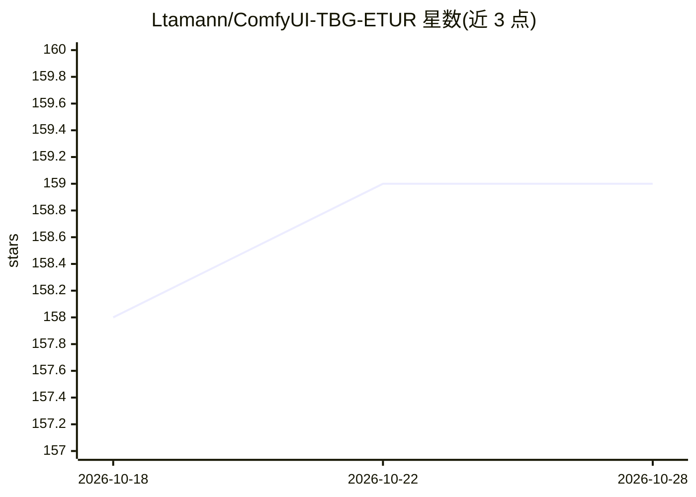

# Ltamann/ComfyUI-TBG-ETUR

⭐ 159 · Python · 推送 2026-09-11 · [GitHub](https://github.com/Ltamann/ComfyUI-TBG-ETUR) · [官网](https://www.patreon.com/c/TB_LAAR) · 组织维护

**ComfyUI 平铺放大与精修节点集：面向 100MP+ 高分辨率生成**

ComfyUI 自定义节点套件，提供平铺式图像放大与精修管线：双模型处理、逐平铺提示词/去噪/种子控制、逐平铺 CFG 与 ControlNet、后期采样逐块重采样、断点续修、SIFT 漂移校正与色彩校正等；支持 Flux 1/2、NVIDIA PiD 作为平铺放大器、Qwen VLM 输出处理，附多个示例工作流。社区版(CE)节点免费，部分 PRO 功能需 Patreon 会员与 API key。安装经 ComfyUI Manager 或手动复制到 custom_nodes 目录并 pip 安装依赖。

## 筛选速览

| 维度 | 判定 | 备注 |
|---|---|---|
| AI 角色 | `ai-native` | 本体是模型或模型工具 |
| 许可风险 | `none` | — |
| 部署形态 | `library` | 以包/库形式分发 |
| 模型依赖 | — | README 未给出锁定关系 |
| 硬件要求 | — | 无带数字的原话,不猜 |
| 安装摩擦 | `medium` | 含编译或系统依赖之一 |
| 成熟度 | `idea` | |

## 能力要点

- 平铺级提示词、去噪、CFG、种子与 ControlNet 覆盖控制
- NGTF 神经生成式平铺融合，支持高去噪下的无缝平铺精修
- 后期采样逐块重采样与多日后单块续修
- 一批独立节点可脱离完整 ETUR 图单独使用

## 适用场景

- 在 ComfyUI 中把图像放大到 100MP 级分辨率并保持一致性
- 对局部不满意时只重采样个别平铺而不重跑全图
- 按区域施加不同提示词与控制条件进行精修

## 场景标签

`图像视频处理` · 领域:感知与多模态

## 证据(README 行号)

> L112: **TBG Enhanced Tiled Upscaler and Refiner Pro** is an advanced, modular enhancement suite for **tiled image genera
> L184:  - search for TGB and install TGB enhancend Upscaler node set or - copy and paste this url: https://github.com/Lta

## 星数曲线

2026-10-18 158 → 2026-10-28 159（+1）

---
*卡片 v1 · prompt 1.4 · 生成 2026-10-22 · 置信度 high · 依据 README sha `01ac344f112e` · [字段定义](../../DATASET.md)*
