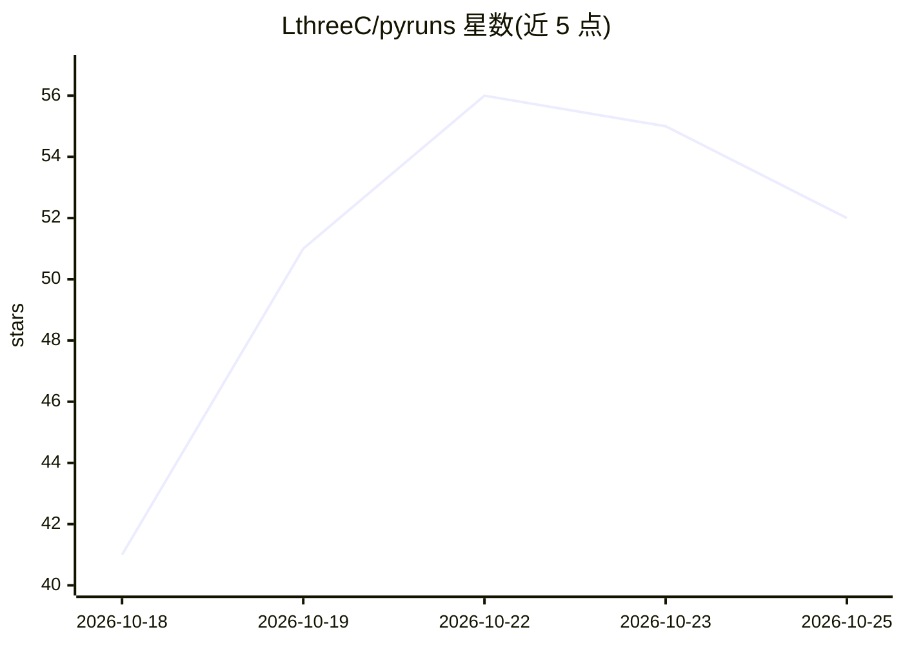

# LthreeC/pyruns

⭐ 52 · Python · MIT · 推送 2026-10-18 · [GitHub](https://github.com/LthreeC/pyruns) · [官网](https://lthreec.github.io/pyruns/) · 个人维护 · 中文 README

**磁盘优先的 Python 实验与终端任务运行管理器**

Pyruns 以 pip 包提供的 CLI 工具（短入口 pyr），把命令、配置、日志、环境变量、运行历史与指标落盘到项目 `_pyruns_` 目录。提供 Git 式一次性 CLI（20 余个子命令）、两种工作区（Shell 与 Script）、argparse 零侵入解析、YAML 批量展开、GPU 空闲等待与多卡排队调度、严格 JSON 输出及可选 Web UI（仅监听本机回环）。面向需要复现实验、批量调参和后台管理长任务的开发者；不是代码沙箱，任务继承当前用户权限。

## 筛选速览

| 维度 | 判定 | 备注 |
|---|---|---|
| AI 角色 | `ai-ecosystem` | LLM/agent 周边工具 |
| 许可风险 | `permissive` | MIT |
| 部署形态 | `library` | 以包/库形式分发 |
| 模型依赖 | — | README 未给出锁定关系 |
| 硬件要求 | — | 无带数字的原话,不猜 |
| 安装摩擦 | `low` | 无编译、无系统依赖或容器化 |
| 成熟度 | — | 结构信号不足 |

## 能力要点

- GPU 空闲等待：按卡数/空闲显存/空闲率/持续秒数/最长等待五项条件排队
- Shell 与 Python 配置实验共用 project→workspace→task→run 生命周期
- pyruns.load()/record()/track() 等脚本内 API 读写配置与指标
- CLI 与 Web UI 共享磁盘状态，支持 --json 与 CSV/JSON 导出

## 适用场景

- 排队等 GPU 空闲后自动跑训练脚本
- 批量展开 YAML 配置做网格调参实验
- 后台运行长任务并随时查看日志与状态
- 用 CI 脚本或 AI agent 通过 JSON 输出自动化提交任务

## 场景标签

`MLOps` · 领域:训练与推理

## 证据(README 行号)

> L12: Pyruns 是一个磁盘优先、面向复现实验和终端任务的运行管理器。它把命令、配置、日志、环境、运行历史和指标保存在项目的 `_pyruns_` 目录中，并提供 Git 式一次性 CLI、GPU 空闲等待（GPU wait）、显存与
> L66: - `--gpu-wait` 按卡数、每卡空闲显存和空闲率等待 GPU 达标后自动运行。

## 星数曲线

2026-10-18 41 → 2026-10-25 52（+11）

---
*卡片 v1 · prompt 1.4 · 生成 2026-10-24 · 置信度 mid · 依据 README sha `dee9a218d10f` · [字段定义](../../DATASET.md)*
