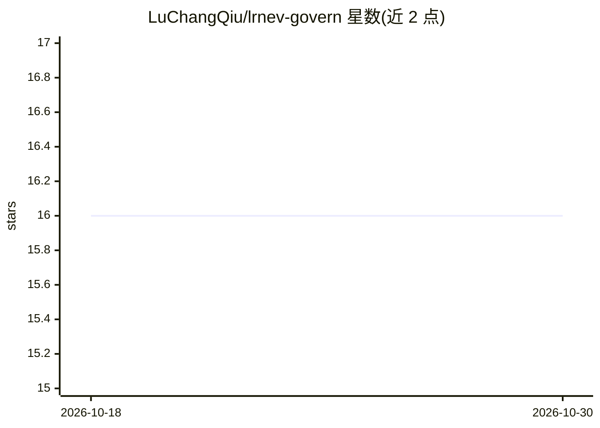

# LuChangQiu/lrnev-govern

⭐ 16 · TypeScript · MIT · 推送 2026-09-10 · [GitHub](https://github.com/LuChangQiu/lrnev-govern) · [官网](https://www.npmjs.com/package/lrnev) · 个人维护 · 中文 README

**AI 协作开发的项目治理引擎：Spec/Task 文件化追溯与结构门禁**

以 MCP 服务 + CLI 双形态提供的项目治理工具：在项目内生成 .lrnev/ Markdown 档案，按 Scene→Spec→Task 组织需求、设计与任务，Task 通过 validates 挂接 F-xx/D-xx 锚点形成验收追溯；三档 Gate（creation/ready/completion）只校验结构契约与占位清除，不判质量。另有 ADR、错误记录、记忆等轻产物与全文检索。零模型依赖（不调 LLM、不联网），摘要由客户端 AI 生成、工具只存取。支持 Agent 注册与 Task claim 做多会话软占用；MCP 仅 stdio transport，工作区即信任边界。面向一人多 AI 窗口接力长期迭代项目的开发者。

## 筛选速览

| 维度 | 判定 | 备注 |
|---|---|---|
| AI 角色 | `ai-ecosystem` | LLM/agent 周边工具 |
| 许可风险 | `permissive` | MIT |
| 部署形态 | `library` | 以包/库形式分发 |
| 模型依赖 | — | README 未给出锁定关系 |
| 硬件要求 | — | 无带数字的原话,不猜 |
| 安装摩擦 | `low` | 无编译、无系统依赖或容器化 |
| 成熟度 | — | 结构信号不足 |

## 能力要点

- Scene→Spec→Task 文件化追溯，Task validates 挂 F-xx/D-xx 锚点
- MCP 服务（42 个工具，可裁 core 33 个）+ CLI 双形态，同一套逻辑
- 三档结构契约 Gate 只查结构不判质量，只引导不强制
- 零模型依赖：不调 LLM、不联网、不依赖数据库，Markdown + frontmatter 可 git 管理

## 适用场景

- 多个 AI 会话接力同一项目时保留上下文与决策记录
- 让代码改动可追溯到需求与验收锚点
- 通过报告命令查看治理欠债与收口缺口
- 给 MCP 工具链补上项目治理骨架

## 场景标签

`Agent 记忆` `知识库管理` · 领域:Agent 开发

## 证据(README 行号)

> L5: 🎯 确定性项目治理引擎：给 AI 协作开发加上 Scene → Spec → Task + Gate 的流程与档案。Markdown 文件即真相，零模型依赖；MCP 服务 + CLI 双形态。
> L57: 🔌 **不绑定客户端**：Claude Code / Cursor / Codex 及任意支持 MCP 的客户端都能接入；不接 MCP 时 CLI 走同一套逻辑。
> L149: - **不调 LLM / 不联网 / 不查源码**：只做**有标准答案**的事——文件读写、ID 分配、状态机、结构校验，全程零模型、零 embedding、不产生模型费用。源码语义（哪个函数调哪个、改这里影响谁）它不管，查代码

## 星数曲线

2026-10-18 16 → 2026-10-30 16（+0）

---
*卡片 v1 · prompt 1.4 · 生成 2026-10-30 · 置信度 high · 依据 README sha `0c62bae2e8bd` · [字段定义](../../DATASET.md)*
