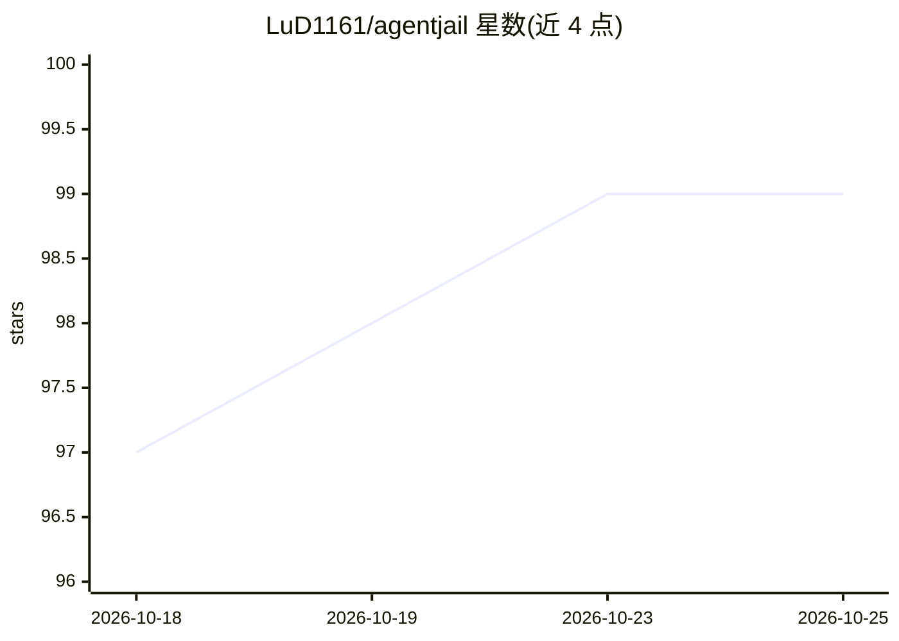

# LuD1161/agentjail

⭐ 99 · Go · Apache-2.0 · 推送 2026-09-24 · [GitHub](https://github.com/LuD1161/agentjail) · [官网](https://agentjail.io) · 个人维护

**给开发者的编码 agent 策略防护与 OS 沙箱工具**

面向使用 Claude Code、Codex、Cursor 的开发者：安装策略钩子后，通过 AgentJail 启动 agent，其工具调用在执行前经本地 OPA Rego 规则判定为 allow/deny/ask（持久 daemon，中位约 8ms），并可叠加 OS 级文件系统沙箱与透明隧道网络管控。内置规则拦截 rm -rf、env 外传、curl|bash、force push 等危险命令，npm publish 等则升级为人工确认。凭据与审批授权失败即拒绝（fail closed）。提供 curl 安装脚本与 Homebrew 两种安装途径，依赖 minisign 校验签名。

## 筛选速览

| 维度 | 判定 | 备注 |
|---|---|---|
| AI 角色 | `ai-ecosystem` | LLM/agent 周边工具 |
| 许可风险 | `permissive` | Apache-2.0 |
| 部署形态 | `desktop` | 安装包/桌面程序 |
| 模型依赖 | — | README 未给出锁定关系 |
| 硬件要求 | — | 无带数字的原话,不猜 |
| 安装摩擦 | `low` | 无编译、无系统依赖或容器化 |
| 成熟度 | — | 结构信号不足 |

## 能力要点

- 工具调用执行前经 OPA Rego 规则本地判定 allow/deny/ask
- OS 级沙箱独立执行文件系统限制，支持 Linux/macOS 网络透明隧道
- 内置拦截 rm -rf、env 外传、pipe-to-shell、force push 等规则
- 凭据与审批授权失败即拒绝（fail closed）

## 适用场景

- 防止编码 agent 误删文件或读取 .env 等敏感路径
- 拦截 agent 执行 env|curl 外传、curl|bash 等危险命令
- npm publish、force push 等不可逆操作升级为人工确认

## 场景标签

`网络安全` · 领域:学习与行业

## 证据(README 行号)

> L5: A safety rail for Claude Code, Codex, and Cursor.
> L83: agentjail-hook ── Unix socket ──▶ agentjail-daemon ──▶ OPA Rego rules

## 星数曲线

2026-10-18 97 → 2026-10-25 99（+2）

---
*卡片 v1 · prompt 1.4 · 生成 2026-10-23 · 置信度 high · 依据 README sha `e4aa130adc22` · [字段定义](../../DATASET.md)*
