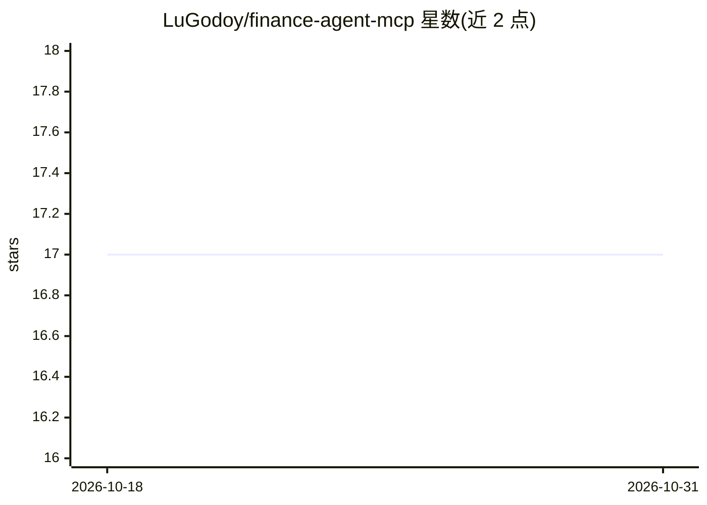

# LuGodoy/finance-agent-mcp

⭐ 17 · Python · MIT · 推送 2026-06-17 · [GitHub](https://github.com/LuGodoy/finance-agent-mcp) · 个人维护 · 中文 README

**面向家庭/团体开支的 AI 对话问答助手（Gemini+MCP+MySQL）**

作者作为技术作品集开发的群组财务助手：成员用自然语言询问开支（如“一月花了多少”），系统经 Gemini LLM 理解意图、通过 MCP Server 的 Tool Calling 在本地 MySQL 上执行参数化 SQL 查询，并以 Streamlit 对话界面返回汇总答案。提供 Docker Compose（自动建库与示例数据）与本地 MySQL 两种运行方式，使用 Makefile 自动化安装与运行，需自备 Gemini API Key。路线图显示多 LLM、多用户认证等功能尚在计划中。

## 筛选速览

| 维度 | 判定 | 备注 |
|---|---|---|
| AI 角色 | `ai-native` | 本体是模型或模型工具 |
| 许可风险 | `permissive` | MIT |
| 部署形态 | `self-host` | docker 或自建部署 |
| 模型依赖 | — | README 未给出锁定关系 |
| 硬件要求 | — | 无带数字的原话,不猜 |
| 安装摩擦 | `low` | 无编译、无系统依赖或容器化 |
| 成熟度 | — | 结构信号不足 |

## 能力要点

- Gemini LLM + MCP Tool Calling 查询本地 MySQL 开支数据
- Docker Compose 一键创建数据库与示例数据
- MCP Server 暴露费用汇总、条目检索等工具，LLM 不直接访问数据库
- 提供基础设施与 agent 两类测试（agent 测试用 mock）

## 适用场景

- 家庭或合租团体用自然语言查询共享开支
- 无需打开表格即可获得月度/按条目的费用汇总
- 作为 MCP + LLM + SQL 架构的学习参考项目

## 场景标签

`数据分析` · 领域:效率与自动化

## 证据(README 行号)

> L11: Assistente inteligente de finanças para grupos utilizando **IA generativa**, arquitetura **MCP (Model Context Proto
> L23: Este assistente permite que qualquer pessoa do grupo faça perguntas em linguagem natural

## 星数曲线

2026-10-18 17 → 2026-10-31 17（+0）

---
*卡片 v1 · prompt 1.4 · 生成 2026-10-30 · 置信度 high · 依据 README sha `fb3bc7df448b` · [字段定义](../../DATASET.md)*
