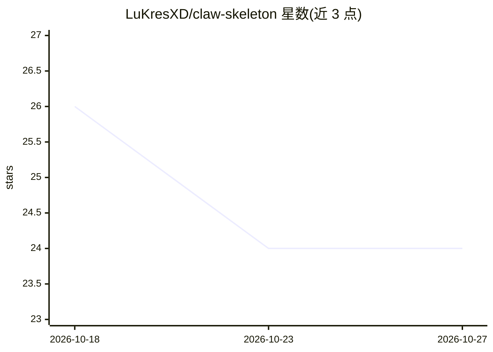

# LuKresXD/claw-skeleton

⭐ 24 · TypeScript · MIT · 推送 2026-08-24 · [GitHub](https://github.com/LuKresXD/claw-skeleton) · 个人维护

**Telegram 个人 AI 助理骨架：每个话题一个独立 Claude Code agent**

TypeScript 实现的 Telegram 机器人：通过 grammY 路由，把超级群的每个 forum topic 映射为一个持久、可恢复的 Claude Code 会话，各自拥有 persona、记忆文件与模型层级；配套分层记忆管道（每日笔记 + 夜间 LLM 汇总升格到 MEMORY.md）、共享 cron 定时任务与 Telegram 富文本输出。本仓库为 2026 年 6 月冻结的免费核心引擎快照，不再维护，收件箱/日历/语音通话等集成已剥离，完整版为付费私有仓库 Claw Pro。运行需 Linux 主机、Node 22+ 与已登录的 Claude Code 订阅。

## 筛选速览

| 维度 | 判定 | 备注 |
|---|---|---|
| AI 角色 | `ai-native` | 本体是模型或模型工具 |
| 许可风险 | `permissive` | MIT |
| 部署形态 | `None` |  |
| 模型依赖 | locked-api |  |
| 硬件要求 | — | 无带数字的原话,不猜 |
| 安装摩擦 | `low` | 无编译、无系统依赖或容器化 |
| 成熟度 | — | 结构信号不足 |

## 能力要点

- 每个 forum topic 一个隔离的持久 Claude Code 会话（persona/记忆/模型层级独立）
- 分层记忆管道：每日笔记经夜间 LLM rollup 升格到 MEMORY.md 并在会话启动时回注
- 共享 cron 运行器触发定时 Claude 任务并把结果路由到对应 topic
- agent 可读取并编辑自身源码、重建并重启（self-maintenance）

## 适用场景

- 在 Telegram 里长期运行一个记得住我的个人助理
- 按话题划分不同 persona 的多个助手（编程/教练/日常）
- 定时任务主动检查并把结果推送到 Telegram 话题

## 场景标签

`AI 助手` · 领域:对话与助手

## 证据(README 行号)

> L5: Every chat topic is its own **isolated Claude Code agent** — with a persona, persistent
> L31: agents**: each forum topic spawns a long-lived, resumable **Claude Code session** with its own
> L50: Architecture: Telegram to a grammY router, which gives each forum topic its own isolated Claude Code session, layer

## 星数曲线

2026-10-18 26 → 2026-10-27 24（-2）

---
*卡片 v1 · prompt 1.4 · 生成 2026-10-27 · 置信度 high · 依据 README sha `a91f9f1c7ebc` · [字段定义](../../DATASET.md)*
