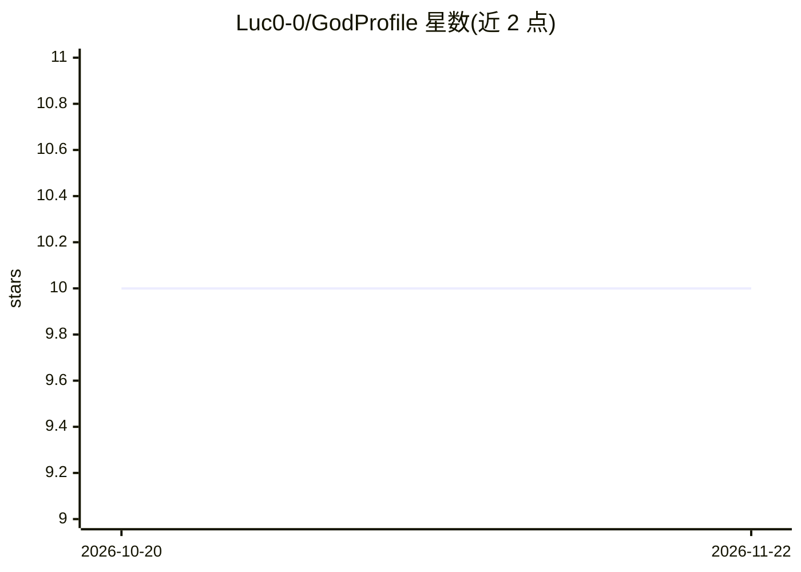

# Luc0-0/GodProfile

⭐ 10 · Python · 推送 2026-04-29 · [GitHub](https://github.com/Luc0-0/GodProfile) · 个人维护

**给 GitHub 个人主页用户的 MCP 工具集：用 16 个工具生成动画 SVG 主页**

一个基于 FastMCP 的 MCP 服务器，为 Claude Desktop 提供 16 个工具：从标准 Markdown 生成玻璃拟态风格的 SVG 组件（终端打字机、图标跑马灯、3D 贡献地球、奖杯架、WakaTime 图表、Spotify 正在播放卡片等）、bento-grid 布局以及 GitHub Actions 自动化配置。渲染工具接受用户提供的数据，实时抓取工具调用 GitHub/WakaTime/Spotify API。提供 uvx 直接运行、pip 安装与源码示例三种方式，无需 API key 即可渲染。

## 筛选速览

| 维度 | 判定 | 备注 |
|---|---|---|
| AI 角色 | `ai-native` | 本体是模型或模型工具 |
| 许可风险 | `none` | — |
| 部署形态 | `library` | 以包/库形式分发 |
| 模型依赖 | locked-api |  |
| 硬件要求 | — | 无带数字的原话,不猜 |
| 安装摩擦 | `low` | 无编译、无系统依赖或容器化 |
| 成熟度 | — | 结构信号不足 |

## 能力要点

- 16 个 MCP 工具：13 个渲染工具 + 3 个实时 API 抓取工具
- 4 套内置主题（luxury-glass/terminal-hacker/minimalist/cyberpunk）
- 除 mcp + pydantic 外零外部依赖，SVG 生成使用 stdlib，输出确定性
- 附 GitHub Actions 自动化与 contribution-snake 配置工具

## 适用场景

- 把 GitHub 个人主页 README 改造成动画 SVG 展示
- 通过 Claude 对话方式迭代生成个人主页组件
- 用 GitHub Actions 定时同步 WakaTime/Spotify 等状态卡片

## 场景标签

 · 领域:开发者工具/个人主页装饰

## 证据(README 行号)

> L5: **The MCP server that turns your GitHub profile README into a god-tier art exhibit.**
> L23: > It ships 16 tools that generate glassmorphic SVGs, animated banners, live data widgets,
> L22: > Give Claude Desktop this server and say: **_"Make my GitHub profile god-tier."_**

## 星数曲线

2026-10-20 10 → 2026-11-22 10（+0）

---
*卡片 v1 · prompt 1.4 · 生成 2026-11-20 · 置信度 mid · 依据 README sha `085180c149d1` · [字段定义](../../DATASET.md)*
