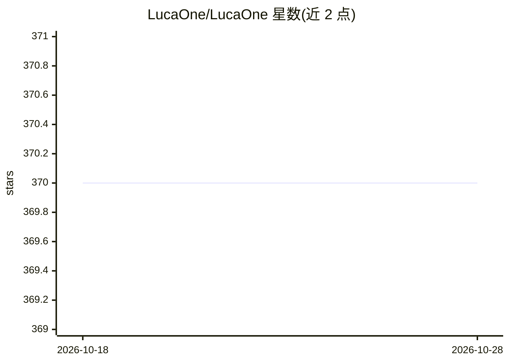

# LucaOne/LucaOne

⭐ 370 · Python · Apache-2.0 · 推送 2026-10-04 · [GitHub](https://github.com/LucaOne/LucaOne) · [官网](https://doi.org/10.5281/zenodo.15171943) · 组织维护 · 中文 README

**统一核酸与蛋白质语言的生物基础模型（LucaOne）资源库**

阿里云 LucaGroup 的生物基础模型 LucaOne（LucaGPLM）官方资源仓库：提供模型代码、预训练脚本（4 个 shell 脚本，覆盖核酸/蛋白混合与单独训练）、嵌入推理代码（src/get_embedding.py）与已训练 checkpoint（含 LucaOne/LucaOne-Gene/LucaOne-Prot 三个版本，按参数自动从 FTP 下载）。2025/12 起支持 Hugging Face 接口（AutoModel 等及序列级/残基级任务头），可用于下游分类、回归与序列恢复任务的微调。预训练数据集存放于 CNSA（CNP0007266）与 FTP，环境需 Python 3.9 + requirements.txt。

## 筛选速览

| 维度 | 判定 | 备注 |
|---|---|---|
| AI 角色 | `ai-native` | 本体是模型或模型工具 |
| 许可风险 | `permissive` | Apache-2.0 |
| 部署形态 | `library` | 以包/库形式分发 |
| 模型依赖 | — | README 未给出锁定关系 |
| 硬件要求 | — | 无带数字的原话,不猜 |
| 安装摩擦 | `low` | 无编译、无系统依赖或容器化 |
| 成熟度 | — | 结构信号不足 |

## 能力要点

- 统一核酸（DNA/RNA）与蛋白质的单一模型架构
- 提供 3 个模型版本 checkpoint（混合/Gene/Prot），按参数自动从 FTP 下载
- 支持 Hugging Face 接口：序列级与残基级分类/回归任务头、MaskedLM
- 含 4 个预训练 shell 脚本与故障续训脚本、TensorBoard 支持

## 适用场景

- 为基因或蛋白序列生成嵌入表征用于下游任务
- 在序列级/残基级任务（蛋白家族、溶解度、结合位点等）上微调模型
- 用自带脚本复现或继续 LucaOne 预训练

## 场景标签

`微调` `模型训练` · 领域:训练与推理

## 证据(README 行号)

> L36: LucaOne: Generalized Biological Foundation Model with Unified Nucleic Acid and Protein Language.
> L47:  - `LucaGPLMModel`: For sequences embedding.

## 星数曲线

2026-10-18 370 → 2026-10-28 370（+0）

---
*卡片 v1 · prompt 1.4 · 生成 2026-10-22 · 置信度 high · 依据 README sha `c8738ad45407` · [字段定义](../../DATASET.md)*
