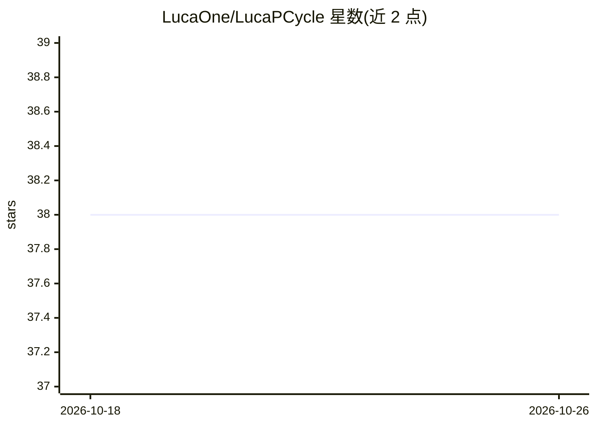

# LucaOne/LucaPCycle

⭐ 38 · Python · Apache-2.0 · 推送 2026-04-28 · [GitHub](https://github.com/LucaOne/LucaPCycle) · 组织维护 · 中文 README

**预测蛋白序列解磷功能的双通道深度学习模型（二分类+31类细分）**

基于原始序列与蛋白语言大模型的双通道模型 LucaPCycle，两阶段预测蛋白质序列是否具有解磷功能：先做二分类识别，再对阳性序列做 31 类细粒度功能类型分类。以 Python 源码仓库形式提供，需自建 conda 环境（Python 3.9）并安装依赖；训练好的 Checkpoint 可自动从 FTP 下载或手动获取。推理通过 src/prediction.py 脚本执行，示例命令使用 CUDA 多卡环境。注意最新代码在 V3 分支而非 master。

## 筛选速览

| 维度 | 判定 | 备注 |
|---|---|---|
| AI 角色 | `ai-native` | 本体是模型或模型工具 |
| 许可风险 | `permissive` | Apache-2.0 |
| 部署形态 | `library` | 以包/库形式分发 |
| 模型依赖 | — | README 未给出锁定关系 |
| 硬件要求 | — | 无带数字的原话,不猜 |
| 安装摩擦 | `low` | 无编译、无系统依赖或容器化 |
| 成熟度 | — | 结构信号不足 |

## 能力要点

- 双通道架构：原始序列+蛋白语言大模型
- 两阶段预测：二分类识别 + 31 类细粒度功能分类
- Trained Checkpoint 自动/手动从 FTP 下载
- 提供 FASTA 输入的命令行推理脚本

## 适用场景

- 判断未知蛋白序列是否具有解磷功能
- 对解磷阳性蛋白进一步细分 31 种功能类型
- 微生物组/宏基因组挖掘中筛选解磷相关基因

## 场景标签

 · 领域:生物信息学/蛋白质功能预测

## 证据(README 行号)

> L2: We developed a dual-channel model named LucaPCycle, based on the raw sequence and protein language large models, to 
> L4: We constructed two models, including an identification model(binary classification) and a fine-grained classificatio

## 星数曲线

2026-10-18 38 → 2026-10-26 38（+0）

---
*卡片 v1 · prompt 1.4 · 生成 2026-10-25 · 置信度 high · 依据 README sha `a549c622278c` · [字段定义](../../DATASET.md)*
