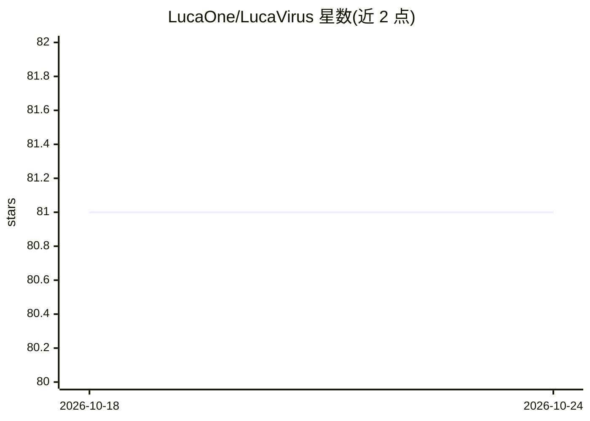

# LucaOne/LucaVirus

⭐ 81 · Python · Apache-2.0 · 推送 2026-05-25 · [GitHub](https://github.com/LucaOne/LucaVirus) · [官网](https://zenodo.org/records/15703216) · 组织维护

**统一基因-蛋白语言模型：刻画病毒演化与功能图谱**

LucaVirus 是面向病毒序列的统一核酸-蛋白语言模型，基于 LucaOne 框架半监督预训练（MLM 加 7 个生物监督任务），预训练数据 OpenVirus 含 1570 万条病毒序列。支持序列嵌入、序列级/残基级分类回归等下游任务（分类预测、抗体-抗原结合预测等），并提供 Hugging Face 接口（AutoModel 等）用于微调。需 Python 3.9 conda 环境、pip 安装依赖，嵌入推理时自动从 FTP 下载检查点，训练脚本支持单卡或多卡。

## 筛选速览

| 维度 | 判定 | 备注 |
|---|---|---|
| AI 角色 | `ai-native` | 本体是模型或模型工具 |
| 许可风险 | `permissive` | Apache-2.0 |
| 部署形态 | `library` | 以包/库形式分发 |
| 模型依赖 | — | README 未给出锁定关系 |
| 硬件要求 | — | 无带数字的原话,不猜 |
| 安装摩擦 | `low` | 无编译、无系统依赖或容器化 |
| 成熟度 | — | 结构信号不足 |

## 能力要点

- 统一架构处理核酸与蛋白多模态病毒序列
- OpenVirus 预训练语料 1570 万条病毒序列、254 亿 tokens
- Hugging Face 原生支持 AutoModel 及序列/ token 级任务头
- 下游任务覆盖适应度景观预测与抗体-抗原结合预测

## 适用场景

- 我对病毒序列做嵌入表示并用于下游分类预测
- 我用 Hugging Face 接口在自有病毒数据上微调模型
- 我研究病毒蛋白的适应度景观或结合位点

## 场景标签

`模型训练` `微调` · 领域:训练与推理

## 证据(README 行号)

> L56: LucaVirus employs a semi-supervised pre-training strategy, building on the framework established by LucaOne.
> L58: The pre-training process integrates self-supervised masked language modeling (MLM) with seven biologically relevant
> L91: ### 4) Performance of LucaVirus in antibody-antigen binding prediction

## 星数曲线

2026-10-18 81 → 2026-10-24 81（+0）

---
*卡片 v1 · prompt 1.4 · 生成 2026-10-24 · 置信度 high · 依据 README sha `5486cdbe06bc` · [字段定义](../../DATASET.md)*
