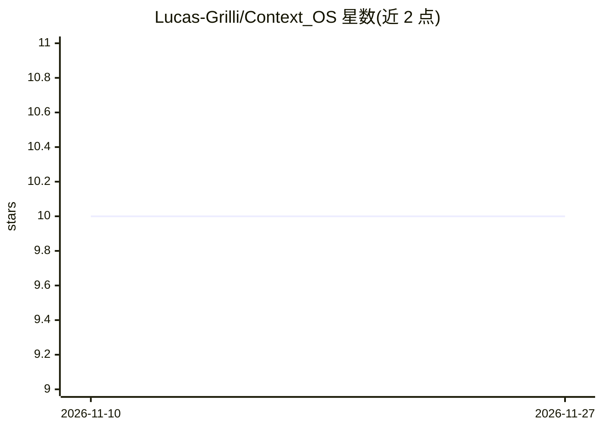

# Lucas-Grilli/Context_OS

⭐ 10 · MIT · 推送 2026-11-06 · [GitHub](https://github.com/Lucas-Grilli/Context_OS) · 个人维护

**给个人 AI 助手用的自维护第二大脑文件夹系统**

一个纯 markdown 文件夹构成的本地知识系统：由 CLAUDE.md 路由规则、memory.md 状态文件和 7 个技能流程（SKILL.md）组成，AI 助手在每次会话前自行读取状态，通过「路由→索引→单文件」的单路径读取控制 token 消耗。面向在多个项目间切换、不想反复向助手解释背景的个人用户。限制：不支持跨设备同步、不自动导入已有笔记、仅单人使用，且只在 Claude Cowork 上验证过。

## 筛选速览

| 维度 | 判定 | 备注 |
|---|---|---|
| AI 角色 | `ai-enhanced` | 去掉 AI 部分产品仍成立 |
| 许可风险 | `permissive` | MIT |
| 部署形态 | `None` |  |
| 模型依赖 | — | README 未给出锁定关系 |
| 硬件要求 | — | 无带数字的原话,不猜 |
| 安装摩擦 | `low` | 无编译、无系统依赖或容器化 |
| 成熟度 | — | 结构信号不足 |

## 能力要点

- CLAUDE.md 路由 + 索引 + 单文件的按需读取机制，示例库 29 万词每会话读 2-3 千词
- 7 个技能流程：Onboarding、Librarian、Project Kick-off、Knowledge Pill、Specialize、System Check、Session Log
- 纯 markdown 文件夹，无数据库、无账号、无云端，数据留在本地
- 规则不含状态（rules never contain state），修正会回写规则本身

## 适用场景

- 在 Claude Code/Cowork 中维护跨会话的项目状态与决策记录
- 把散乱笔记整理成带链接的个人知识库
- 减少每次开新会话重复解释背景的 token 与时间开销

## 场景标签

`知识库管理` `Agent 记忆` · 领域:Agent 开发

## 证据(README 行号)

> L69: The hard part of a knowledge base isn't reading or thinking — it's the bookkeeping: keeping indexes current, knowin
> L87: A folder of markdown files. No database, no account, no subscription, nothing running in the cloud. Opens in any ed
> L120: It was built and tested on Claude Cowork. Being plain text files with natural-language instructions, it works in p

## 星数曲线

2026-11-10 10 → 2026-11-27 10（+0）

---
*卡片 v1 · prompt 1.4 · 生成 2026-11-20 · 置信度 high · 依据 README sha `3e79d252e960` · [字段定义](../../DATASET.md)*
