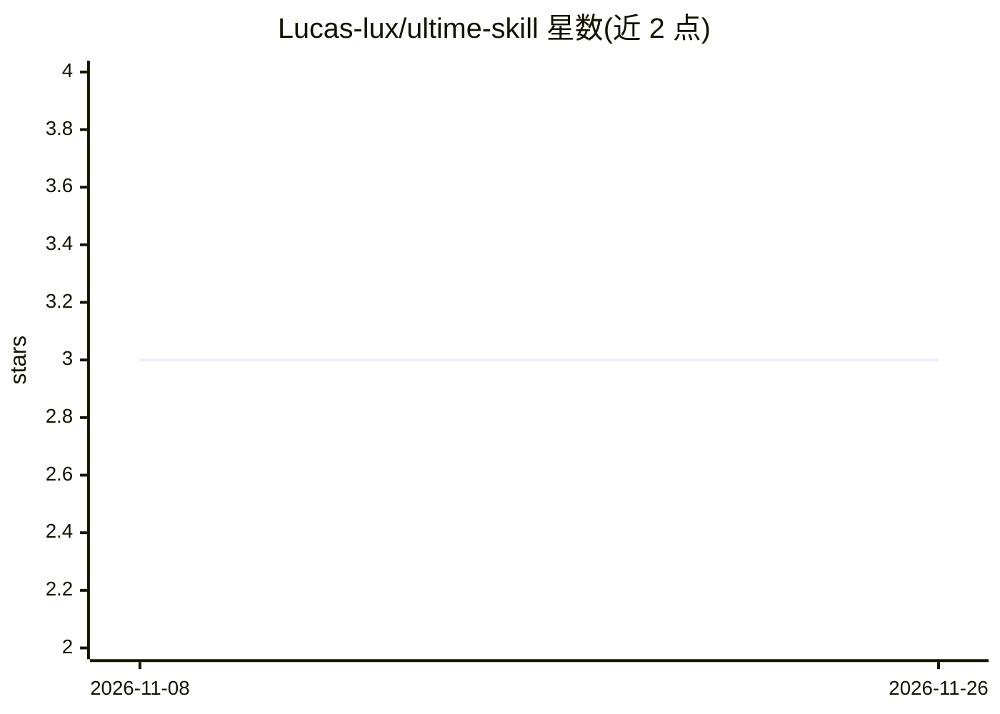

# Lucas-lux/ultime-skill

⭐ 3 · Python · NOASSERTION · 推送 2026-11-01 · [GitHub](https://github.com/Lucas-lux/ultime-skill) · 个人维护 · 中文 README

**为 AI 编码 agent 提供 473 个技能、子代理与守护规则的技能库**

面向 AI 编码 agent 的技能与守护规则库，包含 473 个 skills、24 个 subagents、43 个 packs 与 11 个 bundles。在 Claude Code 中以原生插件形式运行，其余 17 个编码 agent 通过 npx 安装器接入。核心机制包括 app-factory 编排器（八阶段流程与 autopilot 模式）、hook 强制的 guardrails（禁止推送 main、禁止提交密钥、Conventional Commits 等）、按技术栈生成 CI 的 ci-forge，以及按项目裁剪启用包的 ultime-profile 以控制每轮上下文开销。

## 筛选速览

| 维度 | 判定 | 备注 |
|---|---|---|
| AI 角色 | `ai-ecosystem` | LLM/agent 周边工具 |
| 许可风险 | `permissive` | NOASSERTION |
| 部署形态 | `library` | 以包/库形式分发 |
| 模型依赖 | — | README 未给出锁定关系 |
| 硬件要求 | — | 无带数字的原话,不猜 |
| 安装摩擦 | `medium` | 含编译或系统依赖之一 |
| 成熟度 | — | 结构信号不足 |

## 能力要点

- 473 skills / 24 subagents / 43 packs / 11 bundles，MIT 许可
- Claude Code 原生插件，另支持 Codex、Gemini CLI、Cursor、Copilot 等 17 个 agent
- hook 强制的 guardrails：禁止推 main、禁止密钥入库、PR 标题 AI 标记等，可逐条配置
- ultime-profile 按项目类型裁剪包以控制上下文成本

## 适用场景

- 为团队编码 agent 配置安全守护规则与工作流
- 从想法出发用 app-factory 编排器推进项目到生产
- 按项目技术栈生成 lint/测试/安全扫描 CI
- 为移动应用上架 App Store / Google Play 装配发布技能包

## 场景标签

`编码 Agent` · 领域:编码与开发

## 证据(README 行号)

> L7: A production-ready library of skills, subagents and guardrails for AI coding agents. It gives your agent
> L14: **Claude Code** and installs into **Codex, Gemini CLI, Cursor, GitHub Copilot, OpenCode, Qwen Code,
> L105: npx github:Lucas-lux/ultime-skill install [packs or bundles...] --agent <ids|all|auto> [--scope user|project] [--d

## 星数曲线

2026-11-08 3 → 2026-11-26 3（+0）

---
*卡片 v1 · prompt 1.4 · 生成 2026-11-22 · 置信度 high · 依据 README sha `5b91d6378015` · [字段定义](../../DATASET.md)*
