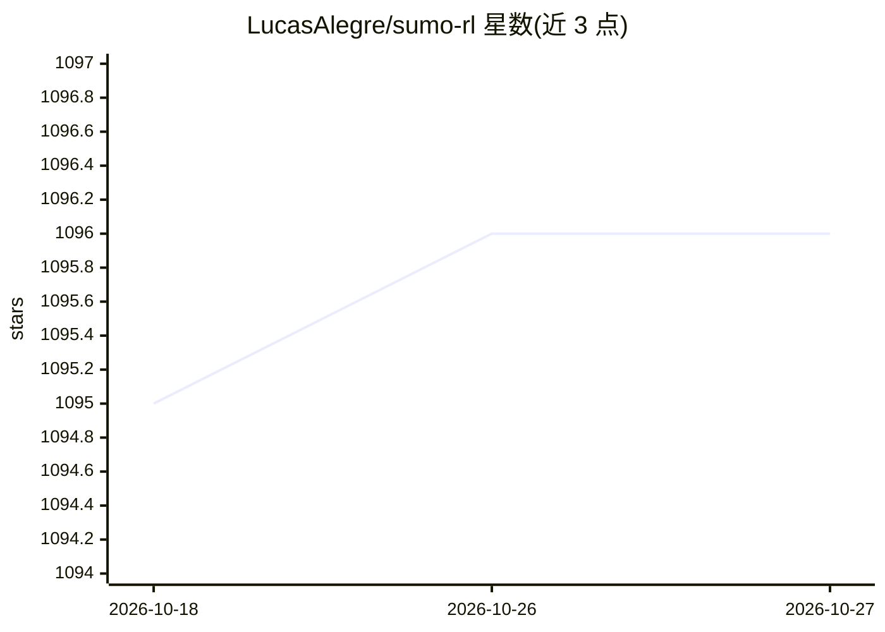

# LucasAlegre/sumo-rl

⭐ 1,096 · Python · MIT · 推送 2026-03-08 · [GitHub](https://github.com/LucasAlegre/sumo-rl) · [官网](https://lucasalegre.github.io/sumo-rl) · 个人维护

**给研究者的交通信号控制强化学习环境库（基于 SUMO）**

基于交通仿真器 SUMO 构建的强化学习环境 Python 库，面向交通信号控制研究。核心类 SumoEnvironment 提供单智能体 Gymnasium Env 与多智能体 PettingZoo（AEC/Parallel）两种接口，通过 TraCI API 读取路网状态并控制信号灯；观测（相位 one-hot、车道密度与排队）、离散动作与奖励函数均可自定义。兼容 stable-baselines3、RLlib 等库，内置 RESCO 基准路网与示例实验。需先系统安装 SUMO 并设置 SUMO_HOME。

## 筛选速览

| 维度 | 判定 | 备注 |
|---|---|---|
| AI 角色 | `ai-ecosystem` | LLM/agent 周边工具 |
| 许可风险 | `permissive` | MIT |
| 部署形态 | `library` | 以包/库形式分发 |
| 模型依赖 | — | README 未给出锁定关系 |
| 硬件要求 | — | 无带数字的原话,不猜 |
| 安装摩擦 | `low` | 无编译、无系统依赖或容器化 |
| 成熟度 | — | 结构信号不足 |

## 能力要点

- 单智能体 Gymnasium 与多智能体 PettingZoo 双接口
- 观测函数与奖励函数可通过继承/传参自定义
- 内置 RESCO 基准网络及 Q-learning/PPO/DQN 示例实验
- 通过 TraCI API 与 SUMO 仿真交互，支持 Libsumo 提速

## 适用场景

- 在 SUMO 路网上训练交通信号控制的 RL 智能体
- 复现或对比交通信号控制 RL 算法（DQN/PPO/Q-learning）
- 多智能体协作式路口/路网控制研究

## 场景标签

`强化学习` · 领域:训练与推理

## 证据(README 行号)

> L10: SUMO-RL provides a simple interface to instantiate Reinforcement Learning (RL) environments with SUMO for Traffic S
> L15: - Compatibility with gymnasium.Env and popular RL libraries such as stable-baselines3 and RLlib
> L19: If instantiated with parameter 'single-agent=True', it behaves like a regular Gymnasium Env.
> L20: For multiagent environments, use env or parallel_env to instantiate a PettingZoo environment with AEC or Parallel A

## 星数曲线

2026-10-18 1,095 → 2026-10-27 1,096（+1）

---
*卡片 v1 · prompt 1.4 · 生成 2026-10-21 · 置信度 high · 依据 README sha `486dedf3d6e8` · [字段定义](../../DATASET.md)*
