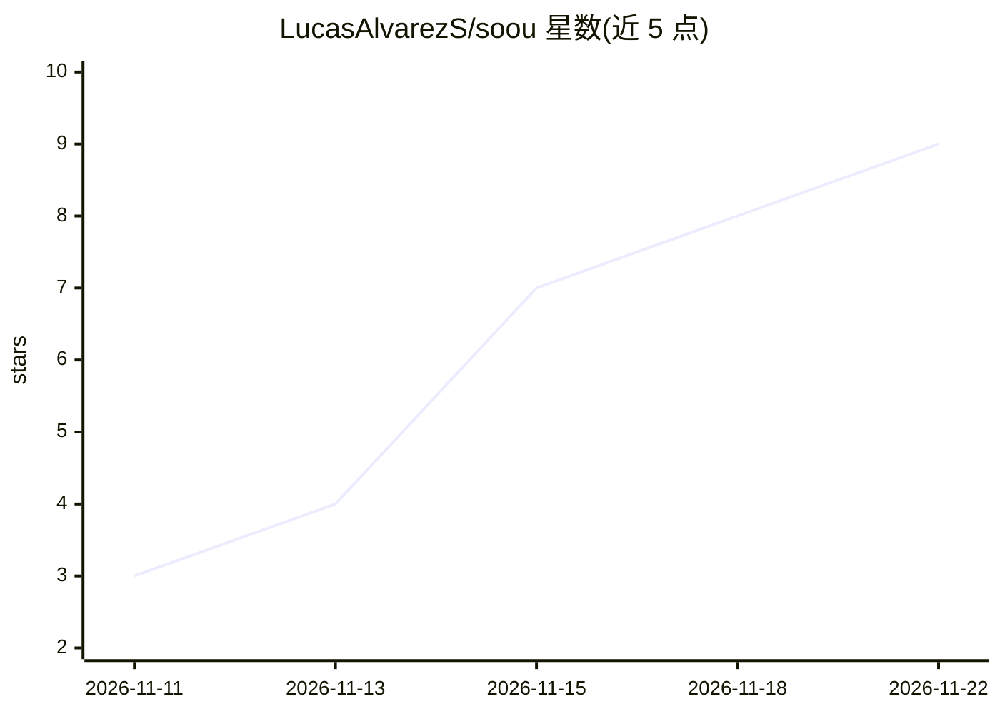

# LucasAlvarezS/soou

⭐ 9 · Python · MIT · 推送 2026-11-13 · [GitHub](https://github.com/LucasAlvarezS/soou) · 个人维护

**给 AI agent 的本地第二大脑，附任务分类与编排**

本地运行的 agent 上下文与编排工具，分两部分：大脑从磁盘收割 agent 会话记录，将转录蒸馏为相互链接的 Markdown 笔记，并通过 MCP server 在 agent 回答前提供上下文；harness 将任务按复杂度与风险分类为 trivial/contextual/complex 等级别，按成本路由到合适的 agent 与模型，写入操作在独立 git worktree 分支上执行且不自动合并。纯 Markdown 为源，仅用 Python 标准库，不绑定任何 AI 供应商；自动收割目前仅支持 Claude Code 与 Codex 两种客户端的转录格式。

## 筛选速览

| 维度 | 判定 | 备注 |
|---|---|---|
| AI 角色 | `ai-ecosystem` | LLM/agent 周边工具 |
| 许可风险 | `permissive` | MIT |
| 部署形态 | `desktop` | 安装包/桌面程序 |
| 模型依赖 | — | README 未给出锁定关系 |
| 硬件要求 | — | 无带数字的原话,不猜 |
| 安装摩擦 | `low` | 无编译、无系统依赖或容器化 |
| 成熟度 | — | 结构信号不足 |

## 能力要点

- 通过 stdio 上的 JSON-RPC 2.0 提供 brain_recall/brain_query 等 MCP 工具
- 两级蒸馏：Level A 无 AI 的确定性摘要与自动链接，Level B 调用可用写作 agent 做概念综合
- 笔记带来源与有效性字段（supersedes 链、sin_verificar 等验证状态）
- 四种接入方式：内置类型、15 种 CLI recipe、任意二进制、OpenAI 兼容 HTTP API

## 适用场景

- 让多个 agent 会话之间共享积累的项目上下文
- 按任务复杂度把简单活路由给低成本模型、复杂活给前沿模型
- 约束 agent 写操作在独立分支上并保留验证状态标记

## 场景标签

`Agent 记忆` `Agent 框架` · 领域:Agent 开发

## 证据(README 行号)

> L38: soou is a **brain** and a **harness**, and neither works well alone.
> L115: The server speaks JSON-RPC 2.0 over `stdio`, written by hand on the standard
> L182: soou belongs to no AI provider. It is the layer between you and whichever agents

## 星数曲线

2026-11-11 3 → 2026-11-22 9（+6）

---
*卡片 v1 · prompt 1.4 · 生成 2026-11-20 · 置信度 mid · 依据 README sha `6535bc32de50` · [字段定义](../../DATASET.md)*
