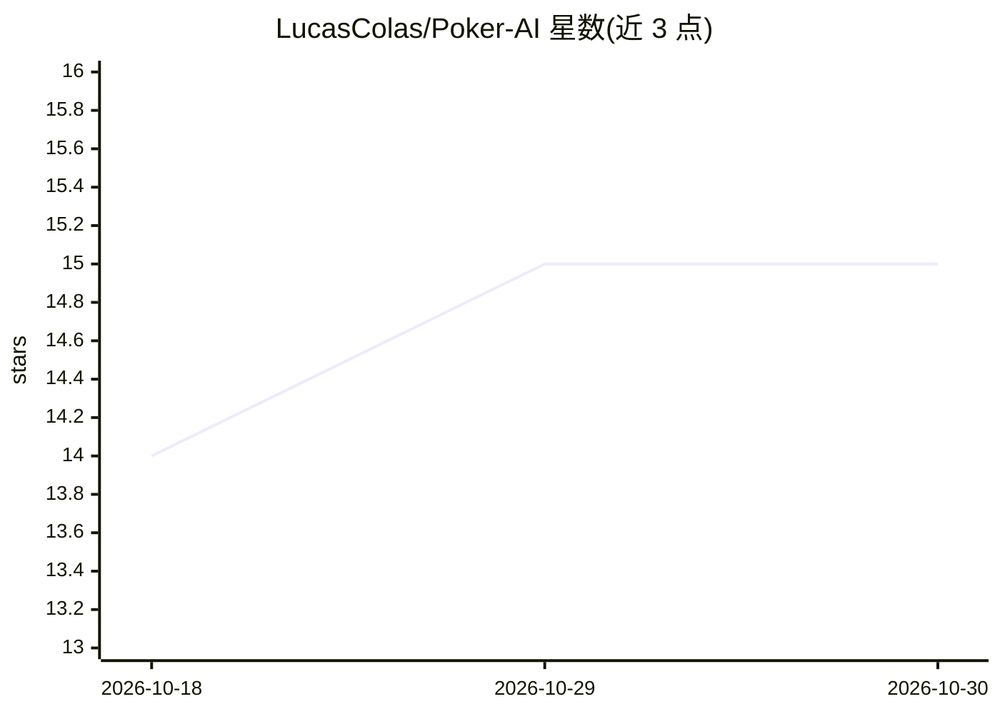

# LucasColas/Poker-AI

⭐ 15 · Python · GPL-3.0 · 推送 2026-10-24 · [GitHub](https://github.com/LucasColas/Poker-AI) · 个人维护

**多种策略打德州扑克的 AI agent 集合及玩家类型聚类**

提供多个可在 Texas Hold'em No Limit 中对局的扑克 agent，采用随机概率、Monte Carlo / MCTS、Outs 等不同决策策略；同时包含聚类功能，用于识别牌桌上各玩家的类型。基于 texasholdem 库实现，需 Python 3.11 及以上，通过 git clone 源码安装，依赖可用 Poetry 或 requirements.txt 两种方式安装，运行入口为 main.py。README 未提供预编译安装包或 Docker。

## 筛选速览

| 维度 | 判定 | 备注 |
|---|---|---|
| AI 角色 | `ai-native` | 本体是模型或模型工具 |
| 许可风险 | `viral` | GPL-3.0 |
| 部署形态 | `library` | 以包/库形式分发 |
| 模型依赖 | — | README 未给出锁定关系 |
| 硬件要求 | — | 无带数字的原话,不猜 |
| 安装摩擦 | `low` | 无编译、无系统依赖或容器化 |
| 成熟度 | — | 结构信号不足 |

## 能力要点

- 多个 agent 使用随机概率、Monte Carlo / MCTS、Outs 等策略
- 通过聚类识别牌桌上玩家类型
- 基于 texasholdem 库构建

## 适用场景

- 在 Texas Hold'em No Limit 对局中测试不同决策策略的 agent
- 分析牌桌上玩家的类型分布

## 场景标签

 · 领域:游戏 AI/强化学习与博弈

## 证据(README 行号)

> L3: Poker Project with agents that can play Texas Hold'em No Limit.
> L6: Agents use different strategies :

## 星数曲线

2026-10-18 14 → 2026-10-30 15（+1）

---
*卡片 v1 · prompt 1.4 · 生成 2026-10-30 · 置信度 mid · 依据 README sha `483de64379db` · [字段定义](../../DATASET.md)*
