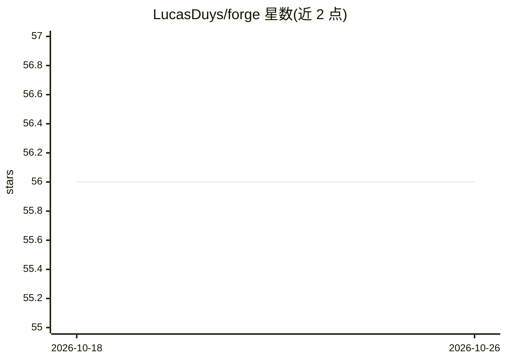

# LucasDuys/forge

⭐ 56 · JavaScript · MIT · 推送 2026-07-15 · [GitHub](https://github.com/LucasDuys/forge) · [官网](https://lucasduys.github.io/forge/) · 个人维护

**Claude Code 插件：把一行想法自动变成已测试已提交的代码**

原生 Claude Code 插件，实现五阶段自主循环：brainstorm 生成带验收标准的规格、plan 生成任务 DAG、execute 在独立 git worktree 中按 TDD 并行执行、review+verify 按四层标准核验、backprop 将运行时失败转化为新验收标准。状态存于磁盘 .forge/ 目录而非对话窗口，崩溃可恢复；提供 token 预算硬上限、输出过滤与读取缓存等节省机制。安装需 Claude Code v1.0.33+，多人模式可选接入 Ably。

## 筛选速览

| 维度 | 判定 | 备注 |
|---|---|---|
| AI 角色 | `ai-ecosystem` | LLM/agent 周边工具 |
| 许可风险 | `permissive` | MIT |
| 部署形态 | `library` | 以包/库形式分发 |
| 模型依赖 | locked-api |  |
| 硬件要求 | — | 无带数字的原话,不猜 |
| 安装摩擦 | `low` | 无编译、无系统依赖或容器化 |
| 成熟度 | — | 结构信号不足 |

## 能力要点

- 五阶段自主循环：规格→任务 DAG→worktree 并行 TDD→审查核验→原子提交
- 状态落盘于 .forge/，崩溃/上下文重置后可从磁盘恢复
- 四层验收核验（存在/实质/接线/运行时），0.3+ 可选 Playwright 视觉门
- token 预算硬上限与输出过滤/读取缓存等节省机制

## 适用场景

- 用一行描述让 Claude Code 自主完成规格、编码、测试与提交
- 多任务并行开发且失败任务不污染主分支
- 团队多人通过分布式认领队列在同一仓库并行推进任务

## 场景标签

`编码 Agent` · 领域:编码与开发

## 证据(README 行号)

> L25: A native Claude Code plugin that turns one-line ideas into reviewed, tested, committed code through a five-phase au
> L40: claude plugin marketplace add LucasDuys/forge

## 星数曲线

2026-10-18 56 → 2026-10-26 56（+0）

---
*卡片 v1 · prompt 1.4 · 生成 2026-10-24 · 置信度 mid · 依据 README sha `d73af5a5df56` · [字段定义](../../DATASET.md)*
