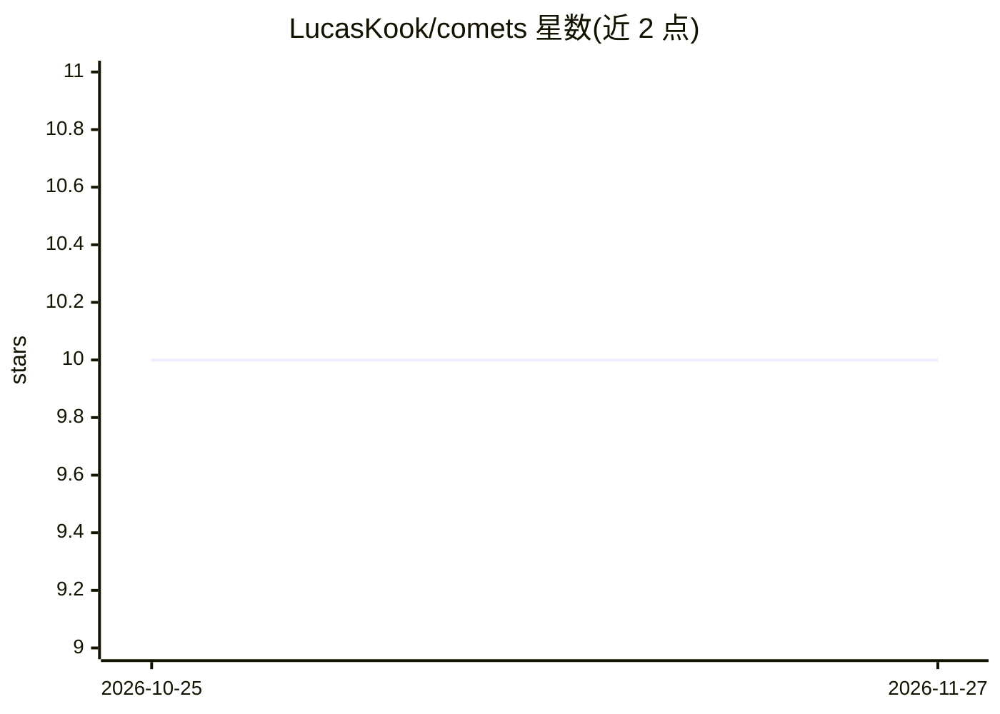

# LucasKook/comets

⭐ 10 · R · 推送 2026-11-13 · [GitHub](https://github.com/LucasKook/comets) · [官网](https://doi.org/10.1093/bib/bbae475) · 组织维护

**多模态监督学习显著性检验的 R 包（GCM/PCM 等检验）**

实现广义、投影、加权与核广义协方差measure检验（GCM/PCM/wGCM/kGCM），检验实值响应 Y 与特征 X 在给定 Z 条件下的条件独立性，回归部分可接入任意有足够预测力的监督学习算法，默认使用 ranger 随机森林，内置 lasso 与自定义回归函数接口。支持生存响应（TRAM-GCM、Cox 模型、随机生存森林）、多变量响应与有序响应（概率森林残差）。提供 R 公式接口 `Y ~ X | Z`，另有 Python 版本；稳定版发布于 CRAN。

## 筛选速览

| 维度 | 判定 | 备注 |
|---|---|---|
| AI 角色 | `ai-native` | 本体是模型或模型工具 |
| 许可风险 | `none` | — |
| 部署形态 | `None` |  |
| 模型依赖 | — | README 未给出锁定关系 |
| 硬件要求 | — | 无带数字的原话,不猜 |
| 安装摩擦 | `low` | 无编译、无系统依赖或容器化 |
| 成熟度 | — | 结构信号不足 |

## 能力要点

- 四种协方差measure检验：GCM/PCM/wGCM/kGCM
- 回归方法可插拔：内置 ranger 随机森林与 lasso，支持自定义回归函数
- 支持生存、多变量、有序三类响应类型的检验扩展
- 提供公式接口 `Y ~ X | Z` 及复现论文结果的脚本

## 适用场景

- 在监督学习模型中检验特征的条件显著性
- 多模态数据中做条件变量显著性检验与模态选择
- 生存数据分析中检验变量与生存时间的条件独立性

## 场景标签

`科研工具` · 领域:学习与行业

## 证据(README 行号)

> L11: survival regression methods and probability forests. The `comets` R package
> L13: interface which allows the user to use any sufficiently predictive supervised
> L238: title={{Algorithm-Agnostic Significance Testing in Supervised Learning With Multimodal Data}},

## 星数曲线

2026-10-25 10 → 2026-11-27 10（+0）

---
*卡片 v1 · prompt 1.4 · 生成 2026-11-20 · 置信度 high · 依据 README sha `06dcd505b1e7` · [字段定义](../../DATASET.md)*
