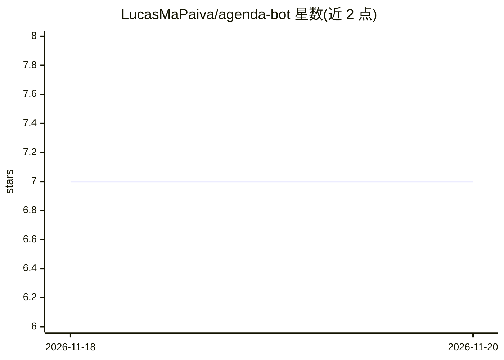

# LucasMaPaiva/agenda-bot

⭐ 7 · Python · 推送 2026-11-12 · [GitHub](https://github.com/LucasMaPaiva/agenda-bot) · 个人维护

**两人共用的 Telegram 日程 bot：本地 LLM 解析自然语言管理 Google 日历**

面向 Matheus 与 Letícia 两位注册用户的私人 Telegram bot：接收自由文本消息，简单意图由规则识别，其余交由服务器上的本地 Gemma 3 1B（Ollama）按 schema 输出 JSON，解析出标题、时间与负责人后经预览确认再写入共享 Google 日历；可选 Gemini 作为本地模型失败时的 fallback。日程查询、冲突计算、空闲时段与计划安排均为确定性代码；支持提醒推送、事件编辑/复制/撤销，以及经确认的财务记账查询。81 个测试覆盖解析与确认流程。

## 筛选速览

| 维度 | 判定 | 备注 |
|---|---|---|
| AI 角色 | `ai-native` | 本体是模型或模型工具 |
| 许可风险 | `none` | — |
| 部署形态 | `self-host` | docker 或自建部署 |
| 模型依赖 | local-ok | 支持本地模型 |
| 硬件要求 | — | 无带数字的原话,不猜 |
| 安装摩擦 | `low` | 无编译、无系统依赖或容器化 |
| 成熟度 | — | 结构信号不足 |

## 能力要点

- 本地 Gemma 3 (Ollama) 优先，个人与财务数据不出服务器，Gemini 仅可选 fallback
- LLM 只做字段抽取，日期、冲突、循环与权限由确定性代码计算，写入需确认
- 支持查询今日/明日/本周日程、空闲时段建议、任务计划与批量循环事件
- 81 个测试覆盖非正式表达解析、冲突、持久化与强制确认流程

## 适用场景

- 用一句自然语言在 Telegram 里创建、修改或复制 Google 日历事件
- 接收临近日程的提醒并按负责人分别通知
- 让 bot 从聊天消息中提取记账信息并写入财务应用
- 在小内存 VPS 上自托管，保持数据不离开服务器

## 场景标签

`AI 助手` · 领域:对话与助手

## 证据(README 行号)

> L7: Bot que recebe mensagens em texto livre no Telegram e gerencia o Google Agenda
> L10: mensagens usa um LLM local (Gemma 3 no Ollama) com saída em JSON validada por schema;
> L24: 3. O resto vai para o LLM local, que devolve título, data, hora e responsável em JSON

## 星数曲线

2026-11-18 7 → 2026-11-20 7（+0）

---
*卡片 v1 · prompt 1.4 · 生成 2026-11-20 · 置信度 high · 依据 README sha `0c2c85cfaaca` · [字段定义](../../DATASET.md)*
