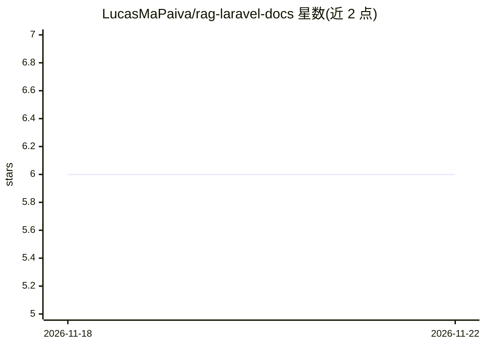

# LucasMaPaiva/rag-laravel-docs

⭐ 6 · Python · 推送 2026-11-13 · [GitHub](https://github.com/LucasMaPaiva/rag-laravel-docs) · 个人维护

**对 Laravel 英文文档做本地 RAG 问答并全程评估的 Python 项目**

围绕 Laravel 官方文档构建的本地 RAG 流水线：按标题分节切块、用 Ollama 生成嵌入并写入 pgvector，检索支持向量、pg_trgm 三元组与 RRF 混合三种策略；内置约 30 个葡语问题的评估集，报告 Recall@5、MRR 与生成引用校验（qwen2.5:7b）。全部本地运行，Web 界面仅用 Python 标准库实现；评估集规模小且权重在同集上选定，README 自行提示结论需新问题验证。

## 筛选速览

| 维度 | 判定 | 备注 |
|---|---|---|
| AI 角色 | `ai-native` | 本体是模型或模型工具 |
| 许可风险 | `none` | — |
| 部署形态 | `self-host` | docker 或自建部署 |
| 模型依赖 | local-ok | 支持本地模型 |
| 硬件要求 | — | 无带数字的原话,不猜 |
| 安装摩擦 | `low` | 无编译、无系统依赖或容器化 |
| 成熟度 | — | 结构信号不足 |

## 能力要点

- 向量 + pg_trgm 三元组 + RRF 混合检索，权重可配置
- 评估集含 Recall@5/MRR 与引用有效性校验（无效编号标记）
- Web 界面用 Python 标准库 http.server 实现，支持策略并排对比
- 嵌入模型支持 nomic-embed-text 与 bge-m3，生成用 qwen2.5:7b

## 适用场景

- 用葡语提问查询 Laravel 英文文档并获取带链接引用的答案
- 对比不同嵌入模型与检索策略的召回表现
- 在无外部 API 的本地环境搭建可评估的 RAG 参考实现

## 场景标签

`RAG` `模型评测` · 领域:评测与运维

## 证据(README 行号)

> L3: Perguntas em português sobre a documentação oficial do Laravel (em inglês), respondidas a
> L5: com **pgvector** e **pg_trgm**, embeddings e modelo de linguagem pelo **Ollama**.
> L16: |4. Avaliação da busca|~30 perguntas em português com a seção esperada; mede se ela aparece entre os 5 primeiros (r

## 星数曲线

2026-11-18 6 → 2026-11-22 6（+0）

---
*卡片 v1 · prompt 1.4 · 生成 2026-11-20 · 置信度 high · 依据 README sha `84d3786fc90b` · [字段定义](../../DATASET.md)*
